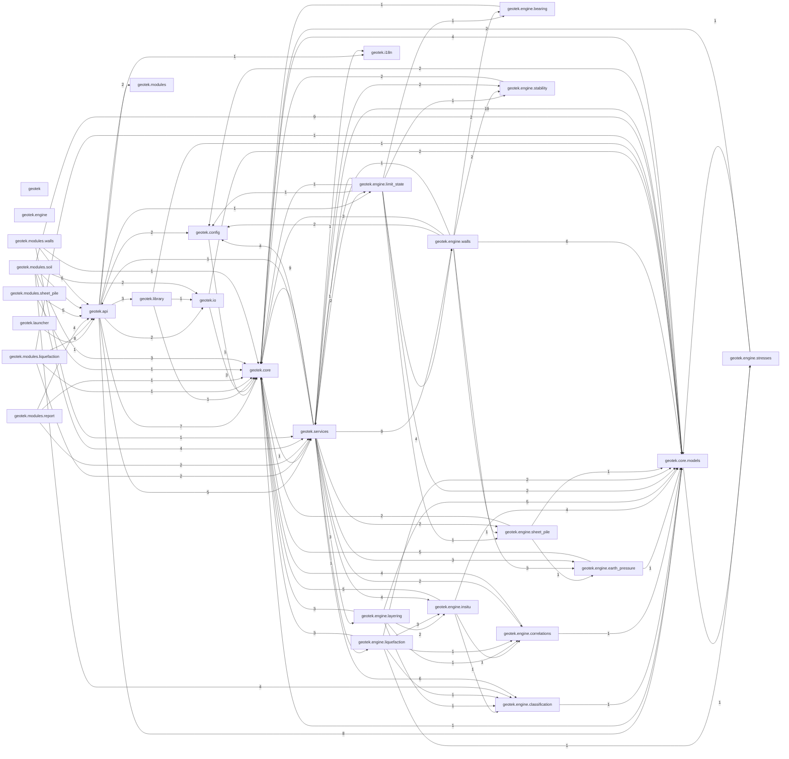
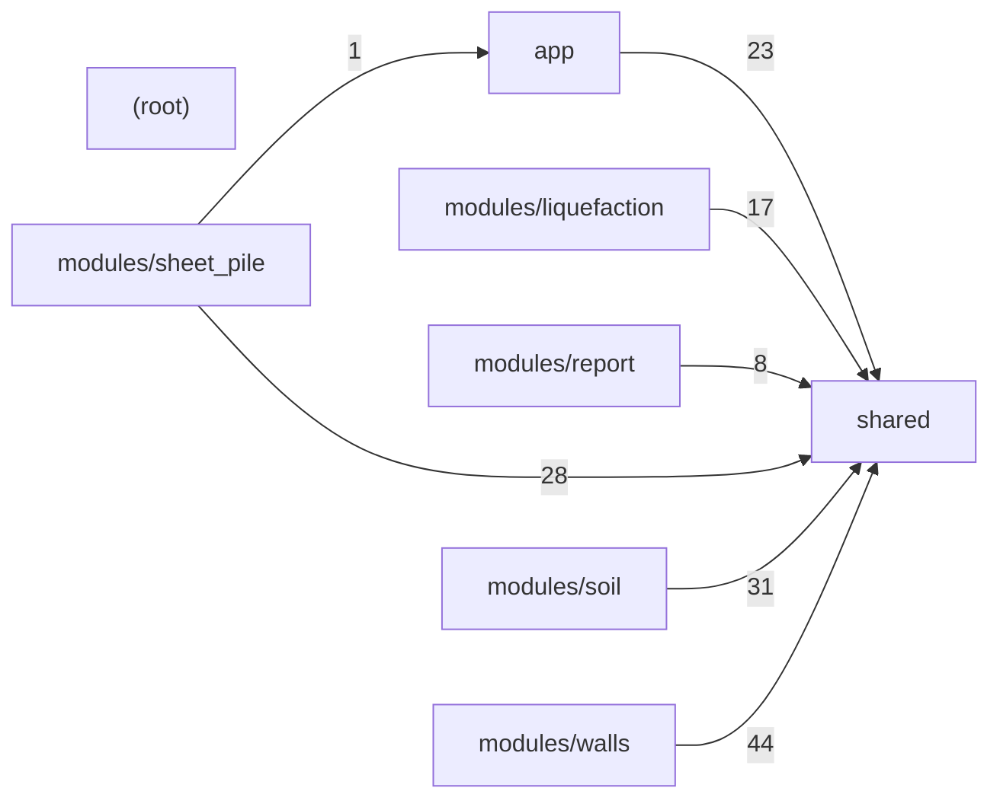

# Kod haritası (bağımlılık şeması)

> **Üretilmiş dosya — elle düzenlemeyin.** `python tools/gen_code_map.py` ile yeniden üretin; `--check` günceli değilse 1 döner. Uygulama kodu çalıştırılmadan Python AST ve sınırlı TypeScript taraması yapılır. Bilinen modül keşfi ve literal Vite glob bağları ayrıca gösterilir.

Hata ararken: önce ilgili paketi şemada bul, sonra dosya tablosunda **Bağımlı olduğu** (aşağı yön) ve **Kullanan** (yukarı yön) sütunlarına bak. Hesap hatası genelde `engine/` → `services/` → `modules/<id>/api.py` → `api/` zincirinin birindedir; arayüz hatası `web/src/modules/<id>/pages` → `api.ts` → `shared/api/http.ts` zincirindedir.

Okuma: `a → b` = a, b'yi import eder. Sayılar paketler arası import kenarı adedidir.

Sınırlar: import grafiği tip/koşullu importları da içerir; çalışma zamanı çağrı grafiği veya mühendislik doğruluk kanıtı değildir. Test bağlantıları doğrudan importlara dayanır, kapsam ölçümü değildir. API eşleştirmesi sabit yollar, tam segment parametreleri ve basit literal URL yardımcılarıyla sınırlıdır; keyfi URL üreticileri, dış paketler, JSON katalogları ve yansıma çalıştırılmaz.

## 0. Modül keşfi

Bunlar import değil, `discovery` bağlarıdır. Paket diyagramlarındaki import sayısına eklenmez.

| Keşfeden | Keşfedilen |
|---|---|
| `geotek/api/registry.py` | `geotek/modules/liquefaction/__init__.py` |
| `geotek/api/registry.py` | `geotek/modules/report/__init__.py` |
| `geotek/api/registry.py` | `geotek/modules/sheet_pile/__init__.py` |
| `geotek/api/registry.py` | `geotek/modules/soil/__init__.py` |
| `geotek/api/registry.py` | `geotek/modules/walls/__init__.py` |
| `web/src/app/moduleRegistry.ts` | `web/src/modules/liquefaction/manifest.ts` |
| `web/src/app/moduleRegistry.ts` | `web/src/modules/report/manifest.ts` |
| `web/src/app/moduleRegistry.ts` | `web/src/modules/sheet_pile/manifest.ts` |
| `web/src/app/moduleRegistry.ts` | `web/src/modules/soil/manifest.ts` |
| `web/src/app/moduleRegistry.ts` | `web/src/modules/walls/manifest.ts` |
| `web/src/shared/api/mock/index.ts` | `web/src/modules/liquefaction/mock.ts` |
| `web/src/shared/api/mock/index.ts` | `web/src/modules/report/mock.ts` |
| `web/src/shared/api/mock/index.ts` | `web/src/modules/sheet_pile/mock.ts` |
| `web/src/shared/api/mock/index.ts` | `web/src/modules/soil/mock.ts` |
| `web/src/shared/api/mock/index.ts` | `web/src/modules/walls/mock.ts` |

## 1. Backend (`geotek/`)

### Paket diyagramı

### Paket bağımlılık tablosu

| Paket | Dosya | Bağımlı olduğu paketler |
|---|---:|---|
| `geotek` | 1 | — |
| `geotek.api` | 10 | `geotek.config`, `geotek.core`, `geotek.core.models`, `geotek.engine.limit_state`, `geotek.i18n`, `geotek.io`, `geotek.library`, `geotek.modules`, `geotek.services` |
| `geotek.config` | 2 | `geotek.core` |
| `geotek.core` | 7 | `geotek.core.models`, `geotek.services` |
| `geotek.core.models` | 7 | `geotek.config`, `geotek.core`, `geotek.engine.stresses` |
| `geotek.engine` | 1 | — |
| `geotek.engine.bearing` | 1 | `geotek.core` |
| `geotek.engine.classification` | 4 | `geotek.core.models` |
| `geotek.engine.correlations` | 6 | `geotek.core`, `geotek.core.models` |
| `geotek.engine.earth_pressure` | 5 | `geotek.core`, `geotek.core.models` |
| `geotek.engine.insitu` | 3 | `geotek.core`, `geotek.core.models`, `geotek.engine.classification`, `geotek.engine.correlations` |
| `geotek.engine.layering` | 4 | `geotek.core`, `geotek.core.models`, `geotek.engine.classification`, `geotek.engine.correlations`, `geotek.engine.insitu` |
| `geotek.engine.limit_state` | 1 | `geotek.config`, `geotek.core`, `geotek.core.models`, `geotek.engine.bearing`, `geotek.engine.sheet_pile`, `geotek.engine.stability`, `geotek.engine.walls`, `geotek.services` |
| `geotek.engine.liquefaction` | 5 | `geotek.core`, `geotek.core.models`, `geotek.engine.classification`, `geotek.engine.correlations`, `geotek.engine.insitu`, `geotek.engine.stresses` |
| `geotek.engine.sheet_pile` | 1 | `geotek.core`, `geotek.core.models`, `geotek.engine.earth_pressure` |
| `geotek.engine.stability` | 1 | `geotek.core` |
| `geotek.engine.stresses` | 1 | `geotek.core`, `geotek.core.models` |
| `geotek.engine.walls` | 5 | `geotek.config`, `geotek.core`, `geotek.core.models`, `geotek.engine.bearing`, `geotek.engine.earth_pressure`, `geotek.engine.sheet_pile`, `geotek.engine.stability`, `geotek.services` |
| `geotek.i18n` | 1 | — |
| `geotek.io` | 3 | `geotek.core`, `geotek.core.models` |
| `geotek.launcher` | 1 | `geotek.api` |
| `geotek.library` | 3 | `geotek.core`, `geotek.core.models`, `geotek.io` |
| `geotek.modules` | 2 | — |
| `geotek.modules.liquefaction` | 3 | `geotek.api`, `geotek.core`, `geotek.core.models`, `geotek.services` |
| `geotek.modules.report` | 3 | `geotek.api`, `geotek.core`, `geotek.services` |
| `geotek.modules.sheet_pile` | 2 | `geotek.api`, `geotek.core` |
| `geotek.modules.soil` | 4 | `geotek.api`, `geotek.core`, `geotek.core.models`, `geotek.engine.classification`, `geotek.io`, `geotek.services` |
| `geotek.modules.walls` | 3 | `geotek.api`, `geotek.core`, `geotek.services` |
| `geotek.services` | 8 | `geotek.api`, `geotek.config`, `geotek.core`, `geotek.core.models`, `geotek.engine.classification`, `geotek.engine.correlations`, `geotek.engine.earth_pressure`, `geotek.engine.insitu`, `geotek.engine.layering`, `geotek.engine.limit_state`, `geotek.engine.liquefaction`, `geotek.engine.sheet_pile`, `geotek.engine.stability`, `geotek.engine.walls`, `geotek.i18n` |

### Backend API rotaları

Modül rotaları `/api/m/<id>` altında bağlanır (`geotek/api/registry.py`); diğerleri `/api` altında.

Yer sütunu işleyicinin `def` satırıdır; çok satırlı dekoratörler AST ile okunur. Web sütunu eşleşen HTTP istemcisidir; sayfa çağıranları import grafiğinden izlenir.

| Metot | Yol | Yer | İşleyici | Web |
|---|---|---|---|---|
| GET | `/api/codes` | `geotek/api/app.py:365` | `list_codes` | `web/src/shared/api/client.ts` |
| GET | `/api/codes/{code_id}/factors` | `geotek/api/app.py:389` | `list_code_factors` | `web/src/shared/api/client.ts` |
| GET | `/api/codes/{code_id}/required` | `geotek/api/app.py:404` | `get_code_required_factors` | `web/src/shared/api/client.ts` |
| GET | `/api/data/profiles` | `geotek/api/app.py:191` | `list_project_profiles` | `web/src/shared/api/core.ts` |
| GET | `/api/health` | `geotek/api/app.py:50` | `get_health` | `web/src/shared/api/client.ts` |
| GET | `/api/i18n/{lang}` | `geotek/api/app.py:56` | `get_i18n` | `web/src/shared/api/client.ts` |
| DELETE | `/api/jobs/{job_id}` | `geotek/api/app.py:360` | `cancel_job` | `web/src/shared/api/client.ts` |
| GET | `/api/jobs/{job_id}` | `geotek/api/app.py:354` | `get_job` | `web/src/shared/api/client.ts` |
| GET | `/api/library` | `geotek/api/library_routes.py:135` | `list_library` | `web/src/shared/api/core.ts` |
| POST | `/api/library` | `geotek/api/library_routes.py:143` | `create_library_project` | `web/src/shared/api/core.ts` |
| POST | `/api/library/import` | `geotek/api/library_routes.py:167` | `import_library_project` | `web/src/shared/api/core.ts` |
| DELETE | `/api/library/{file}` | `geotek/api/library_routes.py:231` | `delete_library_project` | `web/src/shared/api/core.ts` |
| POST | `/api/library/{file}/duplicate` | `geotek/api/library_routes.py:193` | `duplicate_library_project` | `web/src/shared/api/core.ts` |
| POST | `/api/library/{file}/export` | `geotek/api/library_routes.py:218` | `export_library_project` | `web/src/shared/api/core.ts` |
| POST | `/api/library/{file}/open` | `geotek/api/library_routes.py:181` | `open_library_project` | `web/src/shared/api/core.ts` |
| POST | `/api/library/{file}/rename` | `geotek/api/library_routes.py:203` | `rename_library_project` | `web/src/shared/api/core.ts` |
| GET | `/api/m/liquefaction/result` | `geotek/modules/liquefaction/api.py:93` | `get_liquefaction_result` | `web/src/modules/liquefaction/api.ts` |
| POST | `/api/m/liquefaction/run` | `geotek/modules/liquefaction/api.py:31` | `run_liquefaction` | `web/src/modules/liquefaction/api.ts` |
| POST | `/api/m/report/docx` | `geotek/modules/report/api.py:45` | `build_docx` | — |
| GET | `/api/m/report/sections` | `geotek/modules/report/api.py:32` | `list_sections` | `web/src/modules/report/api.ts` |
| POST | `/api/m/sheet_pile/structures/{id}/design` | `geotek/modules/sheet_pile/api.py:21` | `design_sheet_pile` | `web/src/modules/sheet_pile/api.ts` |
| DELETE | `/api/m/soil/boreholes/{id}` | `geotek/modules/soil/api.py:213` | `delete_borehole` | — |
| PUT | `/api/m/soil/boreholes/{id}` | `geotek/modules/soil/api.py:206` | `update_borehole` | — |
| PUT | `/api/m/soil/boreholes/{id}/log` | `geotek/modules/soil/api.py:220` | `set_borehole_log` | — |
| GET | `/api/m/soil/boreholes/{id}/processed` | `geotek/modules/soil/api.py:347` | `get_processed_spt` | `web/src/modules/soil/api.ts` |
| GET | `/api/m/soil/boreholes/{id}/uscs` | `geotek/modules/soil/api.py:314` | `get_borehole_uscs` | `web/src/modules/soil/api.ts` |
| GET | `/api/m/soil/classification/sbtn/reference` | `geotek/modules/soil/api.py:263` | `get_sbtn_reference` | `web/src/modules/soil/api.ts` |
| POST | `/api/m/soil/classification/uscs` | `geotek/modules/soil/api.py:326` | `classify_uscs` | `web/src/modules/soil/api.ts` |
| GET | `/api/m/soil/classification/uscs/reference` | `geotek/modules/soil/api.py:334` | `get_uscs_reference` | `web/src/modules/soil/api.ts` |
| DELETE | `/api/m/soil/cpts/{id}` | `geotek/modules/soil/api.py:235` | `delete_cpt` | — |
| PUT | `/api/m/soil/cpts/{id}` | `geotek/modules/soil/api.py:230` | `update_cpt` | — |
| GET | `/api/m/soil/cpts/{id}/processed` | `geotek/modules/soil/api.py:242` | `get_processed_cpt` | `web/src/modules/soil/api.ts` |
| GET | `/api/m/soil/cpts/{id}/sbtn` | `geotek/modules/soil/api.py:297` | `get_cpt_sbtn` | `web/src/modules/soil/api.ts` |
| POST | `/api/m/soil/import/cpt` | `geotek/modules/soil/api.py:154` | `import_cpt` | — |
| POST | `/api/m/soil/import/spt` | `geotek/modules/soil/api.py:184` | `import_spt` | — |
| GET | `/api/m/soil/investigations` | `geotek/modules/soil/api.py:144` | `list_investigations` | `web/src/modules/soil/api.ts` |
| POST | `/api/m/soil/layering/cpt/{cpt_id}` | `geotek/modules/soil/api.py:366` | `propose_cpt_layers` | `web/src/modules/soil/api.ts` |
| POST | `/api/m/soil/layering/spt/{borehole_id}` | `geotek/modules/soil/api.py:376` | `propose_spt_layers` | `web/src/modules/soil/api.ts` |
| GET | `/api/m/soil/profiles` | `geotek/modules/soil/api.py:383` | `list_profiles` | `web/src/modules/soil/api.ts` |
| POST | `/api/m/soil/profiles` | `geotek/modules/soil/api.py:392` | `create_profile` | `web/src/modules/soil/api.ts` |
| DELETE | `/api/m/soil/profiles/{id}` | `geotek/modules/soil/api.py:446` | `delete_profile` | `web/src/modules/soil/api.ts` |
| GET | `/api/m/soil/profiles/{id}` | `geotek/modules/soil/api.py:401` | `get_profile` | `web/src/modules/soil/api.ts` |
| PUT | `/api/m/soil/profiles/{id}` | `geotek/modules/soil/api.py:424` | `update_profile` | `web/src/modules/soil/api.ts` |
| POST | `/api/m/soil/profiles/{id}/layers/merge` | `geotek/modules/soil/api.py:476` | `merge_layers` | — |
| GET | `/api/m/soil/profiles/{id}/layers/{layer_id}/parameters` | `geotek/modules/soil/api.py:494` | `list_layer_parameters` | `web/src/modules/soil/api.ts` |
| POST | `/api/m/soil/profiles/{id}/layers/{layer_id}/parameters/approve` | `geotek/modules/soil/api.py:531` | `approve_parameters` | `web/src/modules/soil/api.ts` |
| PUT | `/api/m/soil/profiles/{id}/layers/{layer_id}/parameters/{key}` | `geotek/modules/soil/api.py:508` | `update_parameter_selection` | `web/src/modules/soil/api.ts` |
| POST | `/api/m/soil/profiles/{id}/layers/{layer_id}/split` | `geotek/modules/soil/api.py:467` | `split_layer` | — |
| POST | `/api/m/soil/profiles/{id}/parameters/suggest-all` | `geotek/modules/soil/api.py:558` | `suggest_all_parameters` | `web/src/modules/soil/api.ts` |
| POST | `/api/m/walls/structures/{id}/check` | `geotek/modules/walls/api.py:52` | `check_wall` | `web/src/modules/walls/api.ts` |
| POST | `/api/m/walls/structures/{id}/required-factors` | `geotek/modules/walls/api.py:29` | `get_structure_required_factors` | `web/src/modules/walls/api.ts` |
| POST | `/api/m/walls/structures/{id}/size` | `geotek/modules/walls/api.py:44` | `size_wall` | `web/src/modules/walls/api.ts` |
| GET | `/api/m/walls/wall-types` | `geotek/modules/walls/api.py:20` | `list_wall_types` | `web/src/modules/walls/api.ts` |
| GET | `/api/modules` | `geotek/api/library_routes.py:93` | `list_modules` | `web/src/shared/api/core.ts` |
| GET | `/api/project` | `geotek/api/app.py:134` | `get_project` | `web/src/shared/api/client.ts` |
| PUT | `/api/project/active-profile` | `geotek/api/app.py:175` | `set_active_profile` | `web/src/shared/api/client.ts` |
| POST | `/api/project/close` | `geotek/api/app.py:127` | `close_project` | `web/src/shared/api/core.ts` |
| PUT | `/api/project/design-overrides/{code_id}` | `geotek/api/app.py:423` | `set_design_overrides` | `web/src/shared/api/client.ts` |
| PATCH | `/api/project/meta` | `geotek/api/app.py:141` | `update_project_meta` | `web/src/shared/api/client.ts` |
| POST | `/api/project/new` | `geotek/api/app.py:85` | `new_project` | `web/src/shared/api/client.ts` |
| POST | `/api/project/open` | `geotek/api/app.py:93` | `open_project` | `web/src/shared/api/client.ts` |
| POST | `/api/project/save` | `geotek/api/app.py:103` | `save_project_route` | `web/src/shared/api/client.ts`, `web/src/shared/api/core.ts` |
| PUT | `/api/project/site` | `geotek/api/app.py:160` | `set_project_site` | `web/src/shared/api/client.ts` |
| GET | `/api/session` | `geotek/api/library_routes.py:242` | `get_session_info` | `web/src/shared/api/core.ts` |
| GET | `/api/settings` | `geotek/api/library_routes.py:105` | `get_settings` | `web/src/shared/api/core.ts` |
| PUT | `/api/settings` | `geotek/api/library_routes.py:111` | `put_settings` | `web/src/shared/api/core.ts` |
| GET | `/api/structures` | `geotek/api/app.py:206` | `list_structures` | `web/src/shared/api/client.ts` |
| POST | `/api/structures` | `geotek/api/app.py:252` | `create_structure` | `web/src/shared/api/client.ts` |
| DELETE | `/api/structures/{id}` | `geotek/api/app.py:309` | `delete_structure` | `web/src/shared/api/client.ts` |
| GET | `/api/structures/{id}` | `geotek/api/app.py:283` | `get_structure` | `web/src/shared/api/client.ts` |
| PUT | `/api/structures/{id}` | `geotek/api/app.py:290` | `update_structure` | `web/src/shared/api/client.ts` |
| PUT | `/api/structures/{id}/soil` | `geotek/api/app.py:321` | `set_structure_soil` | `web/src/shared/api/client.ts` |
| POST | `/api/structures/{id}/soil/resync` | `geotek/api/app.py:335` | `resync_structure_soil` | `web/src/shared/api/client.ts` |

### Backend dosya tablosu

Test sütunu: o dosyayı doğrudan import eden `tests/` dosyaları (yoksa `—`).

#### `geotek`

| Dosya | Satır | Bağımlı olduğu | Kullanan | Test |
|---|---:|---|---|---|
| `__init__.py` | 3 | — | — | `unit/test_config_i18n.py`, `unit/test_module1_service.py` |

#### `geotek.api`

| Dosya | Satır | Bağımlı olduğu | Kullanan | Test |
|---|---:|---|---|---|
| `api/__init__.py` | 1 | — | `api.app`, `api.calculation_jobs`, `api.calculation_results`, `api.common`, `api.jobs`, `api.library_routes` +5 | `api/test_codes_api.py`, `api/test_contract.py`, `api/test_jobs_api.py` +6 |
| `api/app.py` | 503 | `api`, `api.common`, `api.jobs`, `api.library_routes`, `api.registry`, `api.schemas`, `api.session`, `config.codes`, `core.errors`, `core.models.project`, `core.models.structures`, `i18n`, `io.project_io`, `library`, `services.structures`, `services.walls_advanced` | `launcher` | `api/conftest.py`, `api/test_contract.py`, `api/test_jobs_api.py` +3 |
| `api/calculation_jobs.py` | 96 | `api`, `api.calculation_results`, `api.jobs`, `api.schemas`, `api.session`, `core.errors`, `services`, `services.structures` | `modules.liquefaction.api`, `modules.report.api`, `modules.sheet_pile.api`, `modules.walls.api` | — |
| `api/calculation_results.py` | 160 | `api`, `api.schemas`, `core.warning_codes`, `engine.limit_state`, `services.structures` | `api.calculation_jobs`, `modules.liquefaction.api` | `api/test_sheet_pile_api.py`, `unit/test_structures_service.py` |
| `api/common.py` | 47 | `api`, `api.schemas` | `api.app`, `api.library_routes`, `modules.liquefaction.api`, `modules.report.api`, `modules.sheet_pile.api`, `modules.soil.api` +1 | — |
| `api/jobs.py` | 226 | `api`, `api.schemas`, `api.session`, `core.errors` | `api.app`, `api.calculation_jobs`, `modules.liquefaction.api`, `modules.sheet_pile.api`, `modules.walls.api` | `api/test_jobs_api.py`, `unit/test_sheet_pile_slope.py`, `unit/test_t10c_messages.py` |
| `api/library_routes.py` | 244 | `api`, `api.common`, `api.registry`, `api.schemas`, `api.session`, `core.errors`, `core.models.project`, `library` | `api.app` | `api/test_library_hardening_api.py` |
| `api/registry.py` | 74 | `core.errors`, `core.modules`, `modules`, `modules._index` | `api.app`, `api.library_routes`, `services.report` | `api/test_codes_api.py`, `unit/test_module_manifests.py`, `unit/test_module_registry.py` +1 |
| `api/schemas.py` | 592 | `config.codes`, `core.models.profile`, `core.models.project`, `core.models.structures`, `core.models.walls` | `api.app`, `api.calculation_jobs`, `api.calculation_results`, `api.common`, `api.jobs`, `api.library_routes` +9 | `api/test_contract.py`, `api/test_jobs_api.py`, `api/test_sheet_pile_api.py` +4 |
| `api/session.py` | 97 | `api`, `api.schemas`, `core.models.project`, `io.project_io`, `library` | `api.app`, `api.calculation_jobs`, `api.jobs`, `api.library_routes`, `modules.liquefaction.api`, `modules.report.api` +2 | — |

#### `geotek.config`

| Dosya | Satır | Bağımlı olduğu | Kullanan | Test |
|---|---:|---|---|---|
| `config/__init__.py` | 1 | — | — | `unit/test_limit_state.py` |
| `config/codes.py` | 251 | `core.errors` | `api.app`, `api.schemas`, `core.models.project`, `core.models.walls`, `engine.limit_state`, `engine.walls.base` +5 | `api/test_codes_api.py`, `api/test_contract.py`, `api/test_structures_api.py` +8 |

#### `geotek.core`

| Dosya | Satır | Bağımlı olduğu | Kullanan | Test |
|---|---:|---|---|---|
| `core/__init__.py` | 1 | — | — | — |
| `core/constants.py` | 13 | — | `core.models.investigations`, `core.models.profile`, `core.models.structures`, `engine.correlations.physical`, `engine.correlations.stiffness`, `engine.correlations.strength` +14 | `unit/test_earth_pressure.py`, `unit/test_layering_spt.py`, `unit/test_stresses.py` +5 |
| `core/errors.py` | 89 | `services.walls_advanced` | `api.app`, `api.calculation_jobs`, `api.jobs`, `api.library_routes`, `api.registry`, `config.codes` +24 | `api/test_jobs_api.py`, `unit/test_bearing.py`, `unit/test_config_i18n.py` +22 |
| `core/module_state.py` | 54 | `core.errors`, `core.models.project` | — | `unit/test_project_io_13.py` |
| `core/modules.py` | 76 | `core.errors` | `api.registry`, `modules.liquefaction`, `modules.report`, `modules.sheet_pile`, `modules.soil`, `modules.walls` | `unit/test_module_registry.py`, `unit/test_module_report_hook.py`, `unit/test_new_module.py` |
| `core/units.py` | 79 | `core.errors` | `io.tabular` | `unit/test_units.py` |
| `core/warning_codes.py` | 48 | — | `api.calculation_results`, `engine.correlations.physical`, `engine.insitu.cpt`, `engine.insitu.spt`, `engine.layering.common`, `engine.liquefaction.analysis` +3 | `unit/test_cpt.py`, `unit/test_spt.py`, `unit/test_system_check_engine.py` |

#### `geotek.core.models`

| Dosya | Satır | Bağımlı olduğu | Kullanan | Test |
|---|---:|---|---|---|
| `core/models/__init__.py` | 51 | `core.models.investigations`, `core.models.parameters`, `core.models.profile`, `core.models.project`, `core.models.structures` | — | `conftest.py`, `unit/test_cpt.py`, `unit/test_earth_pressure.py` +18 |
| `core/models/investigations.py` | 161 | `core.constants` | `core.models`, `core.models.project`, `engine.classification.uscs`, `engine.insitu.cpt`, `engine.insitu.spt`, `engine.layering.spt` +5 | `api/test_liquefaction_api.py`, `api/test_report_api.py`, `unit/test_layering_cpt.py` +2 |
| `core/models/parameters.py` | 76 | — | `core.models`, `core.models.profile`, `engine.correlations.registry`, `modules.soil.api`, `modules.soil.schemas`, `modules.soil.service` +1 | `unit/test_parameters_service.py` |
| `core/models/profile.py` | 159 | `core.constants`, `core.errors`, `core.models.parameters`, `engine.stresses` | `api.schemas`, `core.models`, `core.models.project`, `core.models.structures`, `engine.earth_pressure.distribution`, `engine.insitu.cpt` +21 | `api/job_helpers.py`, `api/test_system_check_api.py`, `unit/test_layering_conversion.py` +7 |
| `core/models/project.py` | 113 | `config.codes`, `core.models.investigations`, `core.models.profile`, `core.models.structures` | `api.app`, `api.library_routes`, `api.schemas`, `api.session`, `core.models`, `core.module_state` +9 | `api/job_helpers.py`, `api/test_contract.py`, `api/test_liquefaction_api.py` +13 |
| `core/models/structures.py` | 228 | `core.constants`, `core.models.profile`, `core.models.walls` | `api.app`, `api.schemas`, `core.models`, `core.models.project`, `engine.walls.layered`, `services.structures` | `api/job_helpers.py`, `api/test_report_api.py`, `api/test_soil_api.py` +5 |
| `core/models/walls.py` | 137 | `config.codes` | `api.schemas`, `core.models.structures`, `engine.limit_state`, `engine.walls.base`, `engine.walls.global_stability`, `engine.walls.layered` +4 | `api/job_helpers.py`, `unit/test_levels.py`, `unit/test_limit_state.py` +7 |

#### `geotek.engine`

| Dosya | Satır | Bağımlı olduğu | Kullanan | Test |
|---|---:|---|---|---|
| `engine/__init__.py` | 1 | — | — | `unit/test_structures_service.py`, `unit/test_walls_layered.py` |

#### `geotek.engine.bearing`

| Dosya | Satır | Bağımlı olduğu | Kullanan | Test |
|---|---:|---|---|---|
| `engine/bearing.py` | 173 | `core.errors` | `engine.limit_state`, `engine.walls.base`, `engine.walls.layered` | `unit/test_bearing.py`, `unit/test_system_check_engine.py`, `verification/test_bearing_textbook.py` |

#### `geotek.engine.classification`

| Dosya | Satır | Bağımlı olduğu | Kullanan | Test |
|---|---:|---|---|---|
| `engine/classification/__init__.py` | 1 | — | `modules.soil.api`, `services.report` | `api/test_soil_classification_api.py` |
| `engine/classification/robertson.py` | 94 | — | `engine.insitu.cpt`, `engine.layering.cpt`, `engine.liquefaction.youd2001`, `modules.soil.api`, `services.report` | `api/test_soil_classification_api.py`, `unit/test_cpt.py`, `unit/test_layering_cpt.py` +1 |
| `engine/classification/uscs.py` | 118 | `core.models.investigations` | `modules.soil.api`, `services.layering`, `services.parameters`, `services.report` | `api/test_soil_classification_api.py`, `unit/test_uscs.py` |
| `engine/classification/uscs_names.py` | 112 | — | `modules.soil.api`, `services.report` | `api/test_soil_classification_api.py` |

#### `geotek.engine.correlations`

| Dosya | Satır | Bağımlı olduğu | Kullanan | Test |
|---|---:|---|---|---|
| `engine/correlations/__init__.py` | 14 | `engine.correlations.physical`, `engine.correlations.registry`, `engine.correlations.stiffness`, `engine.correlations.strength` | `services.parameters` | `unit/test_correlations.py` |
| `engine/correlations/checks.py` | 47 | — | `engine.correlations.physical`, `engine.correlations.stiffness`, `engine.correlations.strength` | — |
| `engine/correlations/physical.py` | 98 | `core.constants`, `core.warning_codes`, `engine.correlations.checks`, `engine.correlations.registry` | `engine.correlations`, `engine.insitu.cpt`, `engine.layering.cpt`, `engine.liquefaction.analysis` | `unit/test_system_check_engine.py`, `verification/test_bi2014_case_histories.py` |
| `engine/correlations/registry.py` | 161 | `core.models.parameters` | `engine.correlations`, `engine.correlations.physical`, `engine.correlations.stiffness`, `engine.correlations.strength`, `services.parameters` | `unit/test_layering_cpt.py`, `unit/test_system_check_engine.py` |
| `engine/correlations/stiffness.py` | 34 | `core.constants`, `engine.correlations.checks`, `engine.correlations.registry` | `engine.correlations` | — |
| `engine/correlations/strength.py` | 153 | `core.constants`, `engine.correlations.checks`, `engine.correlations.registry` | `engine.correlations` | — |

#### `geotek.engine.earth_pressure`

| Dosya | Satır | Bağımlı olduğu | Kullanan | Test |
|---|---:|---|---|---|
| `engine/earth_pressure/__init__.py` | 0 | — | — | — |
| `engine/earth_pressure/coefficients.py` | 196 | `core.errors` | `engine.earth_pressure.distribution`, `engine.walls.base`, `services.structures`, `services.walls_basic` | `unit/test_earth_pressure.py`, `unit/test_earth_pressure_crosscheck.py`, `unit/test_levels.py` +7 |
| `engine/earth_pressure/distribution.py` | 283 | `core.constants`, `core.errors`, `core.models.profile`, `engine.earth_pressure.coefficients`, `engine.earth_pressure.log_spiral` | `engine.sheet_pile`, `engine.walls.layered`, `services.structures` | `unit/test_earth_pressure.py`, `unit/test_sheet_pile_slope.py`, `unit/test_structures_service.py` +1 |
| `engine/earth_pressure/log_spiral.py` | 110 | `core.errors` | `engine.earth_pressure.distribution` | `unit/test_earth_pressure.py`, `verification/test_earth_pressure_textbook.py` |
| `engine/earth_pressure/wedge.py` | 109 | `core.errors` | `engine.walls.base` | `unit/test_earth_pressure_crosscheck.py`, `unit/test_sheet_pile_slope.py`, `unit/test_walls_layered.py` |

#### `geotek.engine.insitu`

| Dosya | Satır | Bağımlı olduğu | Kullanan | Test |
|---|---:|---|---|---|
| `engine/insitu/__init__.py` | 1 | — | — | — |
| `engine/insitu/cpt.py` | 213 | `core.constants`, `core.errors`, `core.models.investigations`, `core.models.profile`, `core.warning_codes`, `engine.classification.robertson`, `engine.correlations.physical` | `engine.layering.cpt`, `engine.liquefaction.analysis`, `engine.liquefaction.common`, `services.module1`, `services.parameters` | `api/test_soil_api.py`, `unit/test_cpt.py`, `unit/test_layering_cpt.py` +2 |
| `engine/insitu/spt.py` | 132 | `core.constants`, `core.models.investigations`, `core.models.profile`, `core.warning_codes` | `engine.layering.spt`, `engine.liquefaction.analysis`, `services.module1`, `services.parameters` | `api/test_soil_api.py`, `unit/test_layering_spt.py`, `unit/test_liquefaction_analysis.py` +1 |

#### `geotek.engine.layering`

| Dosya | Satır | Bağımlı olduğu | Kullanan | Test |
|---|---:|---|---|---|
| `engine/layering/__init__.py` | 39 | `core.models.profile`, `engine.layering.common`, `engine.layering.cpt`, `engine.layering.spt` | `services.layering` | `unit/test_layering_conversion.py`, `unit/test_layering_cpt.py`, `unit/test_layering_spt.py` |
| `engine/layering/common.py` | 143 | `core.constants`, `core.models.profile`, `core.warning_codes` | `engine.layering`, `engine.layering.cpt`, `engine.layering.spt`, `services.layering`, `services.parameters` | `api/test_soil_parameters_api.py`, `unit/test_layering_common.py`, `unit/test_layering_cpt.py` +2 |
| `engine/layering/cpt.py` | 175 | `core.models.profile`, `engine.classification.robertson`, `engine.correlations.physical`, `engine.insitu.cpt`, `engine.layering.common` | `engine.layering` | — |
| `engine/layering/spt.py` | 215 | `core.constants`, `core.models.investigations`, `core.models.profile`, `engine.insitu.spt`, `engine.layering.common` | `engine.layering` | — |

#### `geotek.engine.limit_state`

| Dosya | Satır | Bağımlı olduğu | Kullanan | Test |
|---|---:|---|---|---|
| `engine/limit_state.py` | 656 | `config.codes`, `core.errors`, `core.models.profile`, `core.models.walls`, `engine.bearing`, `engine.sheet_pile`, `engine.stability`, `engine.walls.base`, `engine.walls.global_stability`, `engine.walls.layered`, `engine.walls.walls`, `services.walls_advanced` | `api.calculation_results`, `services.structures`, `services.walls_advanced` | `unit/test_limit_state.py`, `unit/test_structures_service.py`, `unit/test_walls_layered.py` |

#### `geotek.engine.liquefaction`

| Dosya | Satır | Bağımlı olduğu | Kullanan | Test |
|---|---:|---|---|---|
| `engine/liquefaction/__init__.py` | 16 | `engine.liquefaction.analysis`, `engine.liquefaction.common` | `engine.liquefaction.analysis`, `services.module1` | `unit/test_liquefaction_analysis.py`, `unit/test_liquefaction_methods.py`, `unit/test_module1_service.py` +5 |
| `engine/liquefaction/analysis.py` | 225 | `core.models.profile`, `core.warning_codes`, `engine.correlations.physical`, `engine.insitu.cpt`, `engine.insitu.spt`, `engine.liquefaction`, `engine.liquefaction.boulanger_idriss2014`, `engine.liquefaction.common`, `engine.liquefaction.youd2001` | `engine.liquefaction` | `unit/test_liquefaction_analysis.py`, `unit/test_system_check_engine.py` |
| `engine/liquefaction/boulanger_idriss2014.py` | 143 | `core.constants` | `engine.liquefaction.analysis` | `unit/test_liquefaction_methods.py`, `verification/test_bi2014_case_histories.py` |
| `engine/liquefaction/common.py` | 188 | `core.models.profile`, `engine.insitu.cpt`, `engine.stresses` | `engine.liquefaction`, `engine.liquefaction.analysis` | `unit/test_liquefaction_analysis.py`, `unit/test_liquefaction_methods.py`, `unit/test_module1_service.py` +1 |
| `engine/liquefaction/youd2001.py` | 164 | `core.constants`, `engine.classification.robertson` | `engine.liquefaction.analysis` | `unit/test_liquefaction_methods.py`, `verification/test_youd2001_cpt.py`, `verification/test_youd2001_cpt_independent.py` +1 |

#### `geotek.engine.sheet_pile`

| Dosya | Satır | Bağımlı olduğu | Kullanan | Test |
|---|---:|---|---|---|
| `engine/sheet_pile.py` | 295 | `core.constants`, `core.errors`, `core.models.profile`, `engine.earth_pressure.distribution` | `engine.limit_state`, `engine.walls.layered`, `services.structures`, `services.walls_basic` | `api/test_contract.py`, `unit/test_limit_state.py`, `unit/test_sheet_pile.py` +4 |

#### `geotek.engine.stability`

| Dosya | Satır | Bağımlı olduğu | Kullanan | Test |
|---|---:|---|---|---|
| `engine/stability.py` | 236 | `core.constants`, `core.errors` | `engine.limit_state`, `engine.walls.global_stability`, `engine.walls.layered`, `services.walls_advanced`, `services.walls_basic` | `unit/test_limit_state.py`, `unit/test_stability.py`, `unit/test_structures_service.py` +5 |

#### `geotek.engine.stresses`

| Dosya | Satır | Bağımlı olduğu | Kullanan | Test |
|---|---:|---|---|---|
| `engine/stresses.py` | 49 | `core.constants`, `core.errors`, `core.models.profile` | `core.models.profile`, `engine.liquefaction.common` | — |

#### `geotek.engine.walls`

| Dosya | Satır | Bağımlı olduğu | Kullanan | Test |
|---|---:|---|---|---|
| `engine/walls/__init__.py` | 0 | — | — | `unit/test_walls_layered.py` |
| `engine/walls/base.py` | 282 | `config.codes`, `core.errors`, `core.models.walls`, `engine.bearing`, `engine.earth_pressure.coefficients`, `engine.earth_pressure.wedge` | `engine.limit_state`, `engine.walls.global_stability`, `engine.walls.layered`, `engine.walls.walls`, `services.structures`, `services.walls_advanced` +1 | `api/test_contract.py`, `unit/test_structures_service.py`, `unit/test_walls_layered.py` |
| `engine/walls/global_stability.py` | 164 | `config.codes`, `core.models.walls`, `engine.stability`, `engine.walls.base`, `engine.walls.walls` | `engine.limit_state`, `services.structures`, `services.walls_advanced`, `services.walls_basic` | `unit/test_levels.py`, `unit/test_limit_state.py`, `unit/test_walls.py` +1 |
| `engine/walls/layered.py` | 523 | `core.constants`, `core.errors`, `core.models.profile`, `core.models.structures`, `core.models.walls`, `engine.bearing`, `engine.earth_pressure.distribution`, `engine.sheet_pile`, `engine.stability`, `engine.walls.base`, `engine.walls.walls`, `services.walls_basic` | `engine.limit_state`, `services.structures` | `api/job_helpers.py`, `unit/test_sheet_pile_slope.py`, `unit/test_structures_service.py` +2 |
| `engine/walls/walls.py` | 124 | `core.models.walls`, `engine.walls.base` | `engine.limit_state`, `engine.walls.global_stability`, `engine.walls.layered`, `services.walls_advanced`, `services.walls_basic` | `unit/test_levels.py`, `unit/test_limit_state.py`, `unit/test_walls.py` +1 |

#### `geotek.i18n`

| Dosya | Satır | Bağımlı olduğu | Kullanan | Test |
|---|---:|---|---|---|
| `i18n/__init__.py` | 69 | — | `api.app`, `services.report` | `api/test_i18n_api.py`, `api/test_soil_parameters_api.py`, `unit/test_config_i18n.py` +6 |

#### `geotek.io`

| Dosya | Satır | Bağımlı olduğu | Kullanan | Test |
|---|---:|---|---|---|
| `io/__init__.py` | 1 | — | `modules.soil.service` | `unit/test_library_hardening.py` |
| `io/project_io.py` | 113 | `core.errors`, `core.models.project` | `api.app`, `api.session`, `library.service` | `api/test_codes_api.py`, `api/test_project_api.py`, `api/test_soil_api.py` +11 |
| `io/tabular.py` | 169 | `core.errors`, `core.models.investigations`, `core.units` | `modules.soil.service` | `unit/test_io.py`, `unit/test_layering_cpt.py`, `unit/test_layering_spt.py` |

#### `geotek.launcher`

| Dosya | Satır | Bağımlı olduğu | Kullanan | Test |
|---|---:|---|---|---|
| `launcher.py` | 96 | `api.app` | — | `unit/test_launcher.py` |

#### `geotek.library`

| Dosya | Satır | Bağımlı olduğu | Kullanan | Test |
|---|---:|---|---|---|
| `library/__init__.py` | 24 | `library.service`, `library.settings` | `api.app`, `api.library_routes`, `api.session` | `api/conftest.py`, `api/test_codes_api.py`, `api/test_library_api.py` +3 |
| `library/service.py` | 308 | `core.errors`, `core.models.project`, `io.project_io` | `library` | `unit/test_library.py`, `unit/test_library_hardening.py` |
| `library/settings.py` | 76 | — | `library` | `unit/test_library.py` |

#### `geotek.modules`

| Dosya | Satır | Bağımlı olduğu | Kullanan | Test |
|---|---:|---|---|---|
| `modules/__init__.py` | 4 | — | `api.registry` | `unit/test_module_registry.py` |
| `modules/_index.py` | 11 | — | `api.registry` | `unit/test_module_registry.py` |

#### `geotek.modules.liquefaction`

| Dosya | Satır | Bağımlı olduğu | Kullanan | Test |
|---|---:|---|---|---|
| `modules/liquefaction/__init__.py` | 17 | `core.modules`, `modules.liquefaction.api` | — | — |
| `modules/liquefaction/api.py` | 108 | `api`, `api.calculation_jobs`, `api.calculation_results`, `api.common`, `api.jobs`, `api.schemas`, `api.session`, `core.models.project`, `modules.liquefaction.schemas`, `services`, `services.module1` | `modules.liquefaction` | — |
| `modules/liquefaction/schemas.py` | 32 | `api.schemas` | `modules.liquefaction.api` | — |

#### `geotek.modules.report`

| Dosya | Satır | Bağımlı olduğu | Kullanan | Test |
|---|---:|---|---|---|
| `modules/report/__init__.py` | 18 | `core.modules`, `modules.report.api` | — | — |
| `modules/report/api.py` | 63 | `api.calculation_jobs`, `api.common`, `api.session`, `modules.report.schemas`, `services`, `services.report` | `modules.report` | — |
| `modules/report/schemas.py` | 26 | `api.schemas` | `modules.report.api` | — |

#### `geotek.modules.sheet_pile`

| Dosya | Satır | Bağımlı olduğu | Kullanan | Test |
|---|---:|---|---|---|
| `modules/sheet_pile/__init__.py` | 18 | `core.modules`, `modules.sheet_pile.api` | — | — |
| `modules/sheet_pile/api.py` | 25 | `api`, `api.calculation_jobs`, `api.common`, `api.jobs`, `api.schemas` | `modules.sheet_pile` | — |

#### `geotek.modules.soil`

| Dosya | Satır | Bağımlı olduğu | Kullanan | Test |
|---|---:|---|---|---|
| `modules/soil/__init__.py` | 16 | `core.modules`, `modules.soil.api` | `modules.soil.api` | `api/test_soil_api.py` |
| `modules/soil/api.py` | 564 | `api`, `api.common`, `api.schemas`, `api.session`, `core.models.investigations`, `core.models.parameters`, `core.models.profile`, `engine.classification`, `engine.classification.robertson`, `engine.classification.uscs`, `engine.classification.uscs_names`, `modules.soil`, `modules.soil.schemas`, `modules.soil.service`, `services`, `services.layering`, `services.module1`, `services.parameters` | `modules.soil` | — |
| `modules/soil/schemas.py` | 212 | `api.schemas`, `core.models.investigations`, `core.models.parameters`, `core.models.profile` | `modules.soil.api`, `modules.soil.service` | — |
| `modules/soil/service.py` | 275 | `api.session`, `core.constants`, `core.errors`, `core.models.parameters`, `core.models.profile`, `core.models.project`, `io`, `io.tabular`, `modules.soil.schemas` | `modules.soil.api` | `api/test_soil_api.py` |

#### `geotek.modules.walls`

| Dosya | Satır | Bağımlı olduğu | Kullanan | Test |
|---|---:|---|---|---|
| `modules/walls/__init__.py` | 18 | `core.modules`, `modules.walls.api` | — | — |
| `modules/walls/api.py` | 56 | `api`, `api.calculation_jobs`, `api.common`, `api.jobs`, `api.schemas`, `modules.walls.schemas`, `services.structures` | `modules.walls` | — |
| `modules/walls/schemas.py` | 12 | `api.schemas` | `modules.walls.api` | — |

#### `geotek.services`

| Dosya | Satır | Bağımlı olduğu | Kullanan | Test |
|---|---:|---|---|---|
| `services/__init__.py` | 1 | — | `api.calculation_jobs`, `modules.liquefaction.api`, `modules.report.api`, `modules.soil.api`, `services.report` | `api/test_liquefaction_api.py`, `api/test_sheet_pile_api.py`, `api/test_walls_api.py` +4 |
| `services/layering.py` | 65 | `core.models.profile`, `core.models.project`, `engine.classification.uscs`, `engine.layering`, `engine.layering.common`, `services.module1` | `modules.soil.api` | `unit/test_layering_cpt.py`, `unit/test_layering_spt.py` |
| `services/module1.py` | 195 | `core.models.investigations`, `core.models.profile`, `core.models.project`, `core.warning_codes`, `engine.insitu.cpt`, `engine.insitu.spt`, `engine.liquefaction` | `modules.liquefaction.api`, `modules.soil.api`, `services.layering`, `services.report` | `api/test_liquefaction_api.py`, `unit/test_models_v2.py`, `unit/test_module1_service.py` |
| `services/parameters.py` | 437 | `core.models.investigations`, `core.models.parameters`, `core.models.profile`, `core.models.project`, `engine.classification.uscs`, `engine.correlations`, `engine.correlations.registry`, `engine.insitu.cpt`, `engine.insitu.spt`, `engine.layering.common` | `modules.soil.api` | `unit/test_parameters_service.py` |
| `services/report.py` | 480 | `api.registry`, `config.codes`, `core.errors`, `core.models.profile`, `core.models.project`, `core.warning_codes`, `engine.classification`, `engine.classification.robertson`, `engine.classification.uscs`, `engine.classification.uscs_names`, `i18n`, `services`, `services.module1`, `services.structures` | `modules.report.api` | `unit/test_module_report_hook.py`, `unit/test_report_status_guard.py`, `unit/test_t10c_messages.py` |
| `services/structures.py` | 757 | `config.codes`, `core.errors`, `core.models.profile`, `core.models.project`, `core.models.structures`, `core.models.walls`, `core.warning_codes`, `engine.earth_pressure.coefficients`, `engine.earth_pressure.distribution`, `engine.limit_state`, `engine.sheet_pile`, `engine.walls.base`, `engine.walls.global_stability`, `engine.walls.layered`, `services.walls_advanced`, `services.walls_basic` | `api.app`, `api.calculation_jobs`, `api.calculation_results`, `modules.walls.api`, `services.report` | `api/test_sheet_pile_api.py`, `api/test_structures_api.py`, `api/test_walls_api.py` +3 |
| `services/walls_advanced.py` | 346 | `config.codes`, `core.constants`, `core.errors`, `core.models.profile`, `core.models.walls`, `engine.limit_state`, `engine.stability`, `engine.walls.base`, `engine.walls.global_stability`, `engine.walls.walls`, `services.walls_basic` | `api.app`, `core.errors`, `engine.limit_state`, `services.structures` | `api/test_codes_api.py`, `api/test_contract.py`, `api/test_jobs_api.py` +3 |
| `services/walls_basic.py` | 432 | `config.codes`, `core.constants`, `core.errors`, `core.models.profile`, `core.models.walls`, `engine.earth_pressure.coefficients`, `engine.sheet_pile`, `engine.stability`, `engine.walls.base`, `engine.walls.global_stability`, `engine.walls.walls` | `engine.walls.layered`, `services.structures`, `services.walls_advanced` | `api/job_helpers.py`, `api/test_contract.py`, `api/test_sheet_pile_api.py` +5 |

## 2. Web (`web/src/`)

### Klasör diyagramı (testler hariç)

| Klasör | Dosya | Bağımlı olduğu klasörler |
|---|---:|---|
| `(root)` | 1 | — |
| `app` | 12 | `shared` |
| `modules/liquefaction` | 8 | `shared` |
| `modules/report` | 5 | `shared` |
| `modules/sheet_pile` | 14 | `app`, `shared` |
| `modules/soil` | 21 | `shared` |
| `modules/walls` | 17 | `shared` |
| `shared` | 39 | — |

### Web → backend çağrıları

`request("METHOD", "/yol")` çağrıları; yol `/api` önekiyle backend rotalarına denk gelir. `${…}` değişkenleri `{}` ile gösterilir.

| Dosya | Çağrılar |
|---|---|
| `modules/liquefaction/api.ts` | POST `/m/liquefaction/run` GET `/m/liquefaction/result` |
| `modules/report/api.ts` | POST `/m/report/run` GET `/m/report/sections` |
| `modules/sheet_pile/api.ts` | POST `/m/sheet_pile/structures/{}/design` |
| `modules/soil/api.ts` | GET `/m/soil/investigations` GET `/m/soil/cpts/{}/processed` GET `/m/soil/boreholes/{}/processed` POST `/m/soil/layering/cpt/{}` POST `/m/soil/layering/spt/{}` GET `/m/soil/profiles` POST `/m/soil/profiles` GET `/m/soil/profiles/{}` PUT `/m/soil/profiles/{}` DELETE `/m/soil/profiles/{}` GET `/m/soil/profiles/{}/layers/{}/parameters` PUT `/m/soil/profiles/{}/layers/{}/parameters/{}` POST `/m/soil/profiles/{}/layers/{}/parameters/approve` POST `/m/soil/profiles/{}/parameters/suggest-all` GET `/m/soil/classification/sbtn/reference` GET `/m/soil/cpts/{}/sbtn` GET `/m/soil/boreholes/{}/uscs` POST `/m/soil/classification/uscs` GET `/m/soil/classification/uscs/reference` |
| `modules/walls/api.ts` | GET `/m/walls/wall-types` POST `/m/walls/structures/{}/required-factors` POST `/m/walls/structures/{}/size` POST `/m/walls/structures/{}/check` |
| `shared/api/client.ts` | GET `/health` GET `/i18n/{}` POST `/project/new` POST `/project/open` POST `/project/save` GET `/project` PATCH `/project/meta` PUT `/project/site` PUT `/project/active-profile` GET `/structures` POST `/structures` GET `/structures/{}` PUT `/structures/{}` DELETE `/structures/{}` PUT `/structures/{}/soil` POST `/structures/{}/soil/resync` GET `/jobs/{}` DELETE `/jobs/{}` GET `/codes` GET `/codes/{}/factors` GET `/codes/{}/required` PUT `/project/design-overrides/{}` |
| `shared/api/core.ts` | GET `/modules` GET `/settings` PUT `/settings` GET `/library` POST `/library` POST `/library/{}/open` POST `/library/{}/duplicate` POST `/library/{}/rename` POST `/library/{}/export` DELETE `/library/{}` POST `/library/import` GET `/session` POST `/project/save` POST `/project/close` GET `/data/profiles` |

### Web dosya tablosu

Testler yalnız **Kullanan** sütununda görünür; “Test” sütunu o dosyayı import eden test dosyalarıdır.

#### `(root)`

| Dosya | Satır | Bağımlı olduğu | Kullanan | Test |
|---|---:|---|---|---|
| `vite-env.d.ts` | 9 | — | — | — |

#### `app`

| Dosya | Satır | Bağımlı olduğu | Kullanan | Test |
|---|---:|---|---|---|
| `app/App.tsx` | 28 | `app/ModuleShell.tsx`, `app/ProjectProvider.tsx`, `app/RequireProject.tsx`, `app/moduleRegistry.ts`, `app/pages/LauncherPage.tsx`, `app/pages/SettingsPage.tsx`, `app/pages/StartPage.tsx` | `app/main.tsx` | `test/shell.test.tsx`, `test/start_page.test.tsx` |
| `app/ModuleShell.tsx` | 110 | `app/ProjectProvider.tsx`, `app/ThemeToggle.tsx`, `app/i18n.ts`, `app/moduleRegistry.ts`, `shared/api/types.ts`, `shared/components/EmptyState.tsx`, `shared/components/ErrorAlert.tsx` | `app/App.tsx` | — |
| `app/ProjectProvider.tsx` | 120 | `shared/api/client.ts`, `shared/api/core.ts`, `shared/api/http.ts`, `shared/api/types.ts` | `app/App.tsx`, `app/ModuleShell.tsx`, `app/RequireProject.tsx`, `app/pages/LauncherPage.tsx`, `app/pages/StartPage.tsx` | `test/shell.test.tsx` |
| `app/RequireProject.tsx` | 13 | `app/ProjectProvider.tsx`, `shared/components/ErrorAlert.tsx` | `app/App.tsx` | — |
| `app/ThemeToggle.tsx` | 19 | — | `app/ModuleShell.tsx`, `app/pages/LauncherPage.tsx`, `app/pages/StartPage.tsx` | — |
| `app/i18n.ts` | 60 | `shared/api/client.ts`, `shared/api/types.ts` | `app/ModuleShell.tsx`, `app/main.tsx`, `app/pages/LauncherPage.tsx`, `app/pages/SettingsPage.tsx`, `app/pages/StartPage.tsx` +1 | `modules/liquefaction/__tests__/liquefaction.test.tsx`, `modules/liquefaction/__tests__/results.test.tsx`, `modules/report/__tests__/report.test.tsx` +18 |
| `app/main.tsx` | 42 | `app/App.tsx`, `app/i18n.ts`, `app/theme.ts` | — | — |
| `app/moduleRegistry.ts` | 29 | `shared/moduleTypes.ts` | `app/App.tsx`, `app/ModuleShell.tsx`, `app/pages/LauncherPage.tsx` | `test/module_paths.test.ts`, `test/shell.test.tsx` |
| `app/pages/LauncherPage.tsx` | 606 | `app/ProjectProvider.tsx`, `app/ThemeToggle.tsx`, `app/i18n.ts`, `app/moduleRegistry.ts`, `shared/api/client.ts`, `shared/api/types.ts`, `shared/components/EmptyState.tsx`, `shared/components/ErrorAlert.tsx` | `app/App.tsx` | — |
| `app/pages/SettingsPage.tsx` | 152 | `app/i18n.ts`, `shared/api/core.ts`, `shared/api/types.ts`, `shared/components/ErrorAlert.tsx` | `app/App.tsx` | — |
| `app/pages/StartPage.tsx` | 765 | `app/ProjectProvider.tsx`, `app/ThemeToggle.tsx`, `app/i18n.ts`, `shared/api/client.ts`, `shared/api/core.ts`, `shared/api/types.ts`, `shared/components/EmptyState.tsx`, `shared/components/ErrorAlert.tsx` | `app/App.tsx` | — |
| `app/theme.ts` | 31 | — | `app/main.tsx` | `modules/liquefaction/__tests__/liquefaction.test.tsx`, `modules/liquefaction/__tests__/results.test.tsx`, `modules/sheet_pile/__tests__/sheet_pile.test.tsx` +13 |

#### `modules/liquefaction`

| Dosya | Satır | Bağımlı olduğu | Kullanan | Test |
|---|---:|---|---|---|
| `modules/liquefaction/Root.tsx` | 13 | `modules/liquefaction/pages/AnalysisPage.tsx`, `modules/liquefaction/pages/ResultsPage.tsx` | `modules/liquefaction/manifest.ts` | `modules/liquefaction/__tests__/liquefaction.test.tsx` |
| `modules/liquefaction/api.ts` | 13 | `shared/api/http.ts`, `shared/api/types.ts` | `modules/liquefaction/pages/AnalysisPage.tsx`, `modules/liquefaction/pages/ResultsPage.tsx` | `modules/liquefaction/__tests__/liquefaction.test.tsx`, `modules/liquefaction/__tests__/results.test.tsx`, `test/module_paths.test.ts` |
| `modules/liquefaction/components/DepthChart.tsx` | 113 | — | `modules/liquefaction/components/SoundingDetail.tsx` | `modules/liquefaction/__tests__/results.test.tsx` |
| `modules/liquefaction/components/SoundingDetail.tsx` | 74 | `modules/liquefaction/components/DepthChart.tsx`, `shared/api/types.ts`, `shared/hooks/useWarningText.ts` | `modules/liquefaction/pages/ResultsPage.tsx` | — |
| `modules/liquefaction/manifest.ts` | 18 | `modules/liquefaction/Root.tsx`, `shared/moduleTypes.ts` | — | — |
| `modules/liquefaction/mock.ts` | 92 | `shared/api/mock/core.ts`, `shared/api/mock/dispatcher.ts`, `shared/api/mock/store.ts`, `shared/api/types.ts` | — | — |
| `modules/liquefaction/pages/AnalysisPage.tsx` | 282 | `modules/liquefaction/api.ts`, `shared/api/client.ts`, `shared/api/core.ts`, `shared/api/types.ts`, `shared/components/ErrorAlert.tsx` | `modules/liquefaction/Root.tsx` | `modules/liquefaction/__tests__/liquefaction.test.tsx` |
| `modules/liquefaction/pages/ResultsPage.tsx` | 212 | `modules/liquefaction/api.ts`, `modules/liquefaction/components/SoundingDetail.tsx`, `shared/api/client.ts`, `shared/api/types.ts`, `shared/components/EmptyState.tsx`, `shared/components/ErrorAlert.tsx` | `modules/liquefaction/Root.tsx` | `modules/liquefaction/__tests__/results.test.tsx` |

#### `modules/report`

| Dosya | Satır | Bağımlı olduğu | Kullanan | Test |
|---|---:|---|---|---|
| `modules/report/Root.tsx` | 11 | `modules/report/pages/HomePage.tsx` | `modules/report/manifest.ts` | — |
| `modules/report/api.ts` | 18 | `shared/api/http.ts`, `shared/api/types.ts` | `modules/report/pages/HomePage.tsx` | `modules/report/__tests__/report.test.tsx` |
| `modules/report/manifest.ts` | 15 | `modules/report/Root.tsx`, `shared/moduleTypes.ts` | — | — |
| `modules/report/mock.ts` | 53 | `shared/api/mock/dispatcher.ts` | — | — |
| `modules/report/pages/HomePage.tsx` | 141 | `modules/report/api.ts`, `shared/api/client.ts`, `shared/api/types.ts`, `shared/components/EmptyState.tsx`, `shared/components/ErrorAlert.tsx` | `modules/report/Root.tsx` | `modules/report/__tests__/report.test.tsx` |

#### `modules/sheet_pile`

| Dosya | Satır | Bağımlı olduğu | Kullanan | Test |
|---|---:|---|---|---|
| `modules/sheet_pile/Root.tsx` | 15 | `modules/sheet_pile/pages/SheetPileCreatePage.tsx`, `modules/sheet_pile/pages/SheetPileDetailPage.tsx`, `modules/sheet_pile/pages/SheetPileListPage.tsx` | `modules/sheet_pile/manifest.ts` | `modules/sheet_pile/__tests__/sheet_pile.test.tsx` |
| `modules/sheet_pile/api.ts` | 6 | `shared/api/http.ts`, `shared/api/types.ts` | `modules/sheet_pile/pages/SheetPileDetailPage.tsx` | — |
| `modules/sheet_pile/components/InputsForm.tsx` | 114 | `modules/sheet_pile/inputs.ts`, `shared/api/client.ts`, `shared/api/types.ts` | `modules/sheet_pile/pages/SheetPileCreatePage.tsx`, `modules/sheet_pile/pages/SheetPileDetailPage.tsx` | — |
| `modules/sheet_pile/components/JobPanel.tsx` | 102 | `modules/sheet_pile/components/ResultPanel.tsx`, `shared/api/client.ts`, `shared/api/types.ts`, `shared/components/ErrorAlert.tsx` | `modules/sheet_pile/pages/SheetPileDetailPage.tsx` | — |
| `modules/sheet_pile/components/MissingList.tsx` | 32 | — | `modules/sheet_pile/pages/SheetPileCreatePage.tsx`, `modules/sheet_pile/pages/SheetPileDetailPage.tsx` | — |
| `modules/sheet_pile/components/ResultPanel.tsx` | 173 | `app/i18n.ts`, `modules/sheet_pile/series.ts`, `shared/api/types.ts` | `modules/sheet_pile/components/JobPanel.tsx`, `modules/sheet_pile/pages/SheetPileDetailPage.tsx` | `modules/sheet_pile/__tests__/result-contract.test.tsx`, `modules/sheet_pile/__tests__/sheet_pile.test.tsx` |
| `modules/sheet_pile/components/SoilSourceForm.tsx` | 188 | `modules/sheet_pile/inputs.ts`, `shared/api/core.ts`, `shared/api/types.ts`, `shared/components/ErrorAlert.tsx` | `modules/sheet_pile/pages/SheetPileCreatePage.tsx` | — |
| `modules/sheet_pile/inputs.ts` | 207 | `shared/api/types.ts` | `modules/sheet_pile/components/InputsForm.tsx`, `modules/sheet_pile/components/SoilSourceForm.tsx`, `modules/sheet_pile/pages/SheetPileCreatePage.tsx`, `modules/sheet_pile/pages/SheetPileDetailPage.tsx` | `modules/sheet_pile/__tests__/inputs.test.ts` |
| `modules/sheet_pile/manifest.ts` | 17 | `modules/sheet_pile/Root.tsx`, `shared/moduleTypes.ts` | — | `modules/sheet_pile/__tests__/sheet_pile.test.tsx` |
| `modules/sheet_pile/mock.ts` | 70 | `shared/api/mock/core.ts`, `shared/api/mock/dispatcher.ts`, `shared/api/mock/store.ts`, `shared/api/types.ts` | — | — |
| `modules/sheet_pile/pages/SheetPileCreatePage.tsx` | 66 | `modules/sheet_pile/components/InputsForm.tsx`, `modules/sheet_pile/components/MissingList.tsx`, `modules/sheet_pile/components/SoilSourceForm.tsx`, `modules/sheet_pile/inputs.ts`, `shared/api/client.ts`, `shared/components/ErrorAlert.tsx` | `modules/sheet_pile/Root.tsx` | — |
| `modules/sheet_pile/pages/SheetPileDetailPage.tsx` | 292 | `modules/sheet_pile/api.ts`, `modules/sheet_pile/components/InputsForm.tsx`, `modules/sheet_pile/components/JobPanel.tsx`, `modules/sheet_pile/components/MissingList.tsx`, `modules/sheet_pile/components/ResultPanel.tsx`, `modules/sheet_pile/inputs.ts`, `shared/api/client.ts`, `shared/api/types.ts`, `shared/components/EmptyState.tsx`, `shared/components/ErrorAlert.tsx`, `shared/hooks/useProfileName.ts` | `modules/sheet_pile/Root.tsx` | — |
| `modules/sheet_pile/pages/SheetPileListPage.tsx` | 96 | `shared/api/client.ts`, `shared/api/types.ts`, `shared/components/EmptyState.tsx`, `shared/components/ErrorAlert.tsx` | `modules/sheet_pile/Root.tsx` | — |
| `modules/sheet_pile/series.ts` | 62 | — | `modules/sheet_pile/components/ResultPanel.tsx` | `modules/sheet_pile/__tests__/series.test.ts` |

#### `modules/soil`

| Dosya | Satır | Bağımlı olduğu | Kullanan | Test |
|---|---:|---|---|---|
| `modules/soil/Root.tsx` | 17 | `modules/soil/pages/ClassificationPage.tsx`, `modules/soil/pages/ParametersPage.tsx`, `modules/soil/pages/ProfilesPage.tsx`, `modules/soil/pages/SiteDataPage.tsx` | `modules/soil/manifest.ts` | — |
| `modules/soil/api.ts` | 108 | `modules/soil/types.ts`, `shared/api/http.ts`, `shared/api/types.ts` | `modules/soil/components/LayeringModal.tsx`, `modules/soil/pages/ClassificationPage.tsx`, `modules/soil/pages/ParametersPage.tsx`, `modules/soil/pages/ProfilesPage.tsx`, `modules/soil/pages/SiteDataPage.tsx` | `modules/soil/__tests__/parameters_consistency.test.tsx`, `modules/soil/__tests__/soil.test.tsx`, `modules/soil/__tests__/soil_layering_params_ui.test.tsx` +1 |
| `modules/soil/classification/PlasticityChart.tsx` | 110 | `modules/soil/classification/geometry.ts`, `modules/soil/types.ts` | `modules/soil/pages/ClassificationPage.tsx` | `modules/soil/__tests__/classification.test.tsx` |
| `modules/soil/classification/SbtnChart.tsx` | 109 | `modules/soil/classification/geometry.ts`, `modules/soil/types.ts` | `modules/soil/pages/ClassificationPage.tsx` | `modules/soil/__tests__/classification.test.tsx` |
| `modules/soil/classification/geometry.ts` | 125 | — | `modules/soil/classification/PlasticityChart.tsx`, `modules/soil/classification/SbtnChart.tsx`, `modules/soil/pages/ClassificationPage.tsx` | `modules/soil/__tests__/classification.test.tsx` |
| `modules/soil/components/ErrorAlert.tsx` | 21 | `shared/api/errorMessage.ts` | `modules/soil/components/LayeringModal.tsx`, `modules/soil/pages/ClassificationPage.tsx`, `modules/soil/pages/ParametersPage.tsx` | `test/error_alert.test.tsx` |
| `modules/soil/components/LayeringModal.tsx` | 424 | `modules/soil/api.ts`, `modules/soil/components/ErrorAlert.tsx`, `modules/soil/components/WarningList.tsx`, `modules/soil/latest.ts`, `modules/soil/types.ts`, `shared/api/types.ts` | `modules/soil/pages/ProfilesPage.tsx` | `modules/soil/__tests__/soil_layering_params_ui.test.tsx` |
| `modules/soil/components/ParameterKeyCard.tsx` | 321 | `modules/soil/components/WarningList.tsx`, `modules/soil/parameterState.ts`, `modules/soil/units.ts`, `shared/api/types.ts` | `modules/soil/pages/ParametersPage.tsx` | — |
| `modules/soil/components/WarningList.tsx` | 19 | `modules/soil/useWarningText.ts` | `modules/soil/components/LayeringModal.tsx`, `modules/soil/components/ParameterKeyCard.tsx`, `modules/soil/pages/ClassificationPage.tsx` | — |
| `modules/soil/latest.ts` | 21 | — | `modules/soil/components/LayeringModal.tsx`, `modules/soil/pages/ParametersPage.tsx` | `modules/soil/__tests__/parameters_consistency.test.tsx` |
| `modules/soil/manifest.ts` | 20 | `modules/soil/Root.tsx`, `shared/moduleTypes.ts` | — | — |
| `modules/soil/mock.ts` | 736 | `modules/soil/types.ts`, `shared/api/mock/data.ts`, `shared/api/mock/dispatcher.ts`, `shared/api/mock/store.ts`, `shared/api/types.ts`, `shared/soil/layerOps.ts` | — | `modules/soil/__tests__/soil_mock.test.ts` |
| `modules/soil/pages/ClassificationPage.tsx` | 472 | `modules/soil/api.ts`, `modules/soil/classification/PlasticityChart.tsx`, `modules/soil/classification/SbtnChart.tsx`, `modules/soil/classification/geometry.ts`, `modules/soil/components/ErrorAlert.tsx`, `modules/soil/components/WarningList.tsx`, `modules/soil/types.ts`, `shared/components/EmptyState.tsx` | `modules/soil/Root.tsx` | `modules/soil/__tests__/classification.test.tsx` |
| `modules/soil/pages/ParametersPage.tsx` | 319 | `modules/soil/api.ts`, `modules/soil/components/ErrorAlert.tsx`, `modules/soil/components/ParameterKeyCard.tsx`, `modules/soil/latest.ts`, `modules/soil/parameterState.ts`, `modules/soil/units.ts`, `shared/api/client.ts`, `shared/api/types.ts`, `shared/components/EmptyState.tsx` | `modules/soil/Root.tsx` | `modules/soil/__tests__/parameters_consistency.test.tsx`, `modules/soil/__tests__/soil_layering_params_ui.test.tsx` |
| `modules/soil/pages/ProfilesPage.tsx` | 562 | `modules/soil/api.ts`, `modules/soil/components/LayeringModal.tsx`, `shared/api/client.ts`, `shared/api/types.ts`, `shared/components/EmptyState.tsx`, `shared/hooks/useUndoable.ts`, `shared/soil/CommitInputs.tsx`, `shared/soil/GwtEditor.tsx`, `shared/soil/LayerEditor.tsx`, `shared/soil/LayerLegend.tsx`, `shared/soil/SoilColumn.tsx`, `shared/soil/layerOps.ts` | `modules/soil/Root.tsx` | `modules/soil/__tests__/soil.test.tsx` |
| `modules/soil/pages/SiteDataPage.tsx` | 194 | `modules/soil/api.ts`, `modules/soil/types.ts`, `shared/api/client.ts`, `shared/components/EmptyState.tsx` | `modules/soil/Root.tsx` | — |
| `modules/soil/parameterState.ts` | 171 | `shared/api/types.ts` | `modules/soil/components/ParameterKeyCard.tsx`, `modules/soil/pages/ParametersPage.tsx` | `modules/soil/__tests__/parameterState.test.ts` |
| `modules/soil/types.ts` | 147 | `shared/api/types.ts` | `modules/soil/api.ts`, `modules/soil/classification/PlasticityChart.tsx`, `modules/soil/classification/SbtnChart.tsx`, `modules/soil/components/LayeringModal.tsx`, `modules/soil/mock.ts` +2 | `modules/soil/__tests__/classification.test.tsx` |
| `modules/soil/units.ts` | 11 | — | `modules/soil/components/ParameterKeyCard.tsx`, `modules/soil/pages/ParametersPage.tsx` | — |
| `modules/soil/useWarningText.ts` | 1 | `shared/hooks/useWarningText.ts` | `modules/soil/components/WarningList.tsx` | — |
| `modules/soil/warnings.ts` | 1 | `shared/warnings.ts` | — | `modules/soil/__tests__/warnings.test.ts` |

#### `modules/walls`

| Dosya | Satır | Bağımlı olduğu | Kullanan | Test |
|---|---:|---|---|---|
| `modules/walls/Root.tsx` | 15 | `modules/walls/pages/WallListPage.tsx`, `modules/walls/pages/WallTypePicker.tsx`, `modules/walls/pages/WallWizardPage.tsx` | `modules/walls/manifest.ts` | — |
| `modules/walls/api.ts` | 18 | `shared/api/http.ts`, `shared/api/types.ts` | `modules/walls/pages/WallTypePicker.tsx`, `modules/walls/pages/WallWizardPage.tsx` | `modules/walls/__tests__/wall_wizard.test.tsx`, `test/app.test.tsx`, `test/module_paths.test.ts` +1 |
| `modules/walls/components/AnalysisOptionsForm.tsx` | 182 | `modules/walls/settings.ts`, `modules/walls/types.ts` | `modules/walls/pages/WallWizardPage.tsx` | `modules/walls/__tests__/analysis_options.test.tsx` |
| `modules/walls/components/PermeabilityEditor.tsx` | 126 | `modules/walls/settings.ts`, `shared/api/types.ts`, `shared/soil/format.ts` | `modules/walls/pages/WallWizardPage.tsx` | `modules/walls/__tests__/permeability_editor.test.tsx` |
| `modules/walls/components/WallCheckCards.tsx` | 176 | `modules/walls/labels.ts`, `shared/api/types.ts`, `shared/utils/utilisation.ts` | `modules/walls/components/WallResultView.tsx`, `modules/walls/pages/WallWizardPage.tsx` | `modules/walls/__tests__/check_cards.test.tsx` |
| `modules/walls/components/WallCrossSection.tsx` | 252 | `modules/walls/components/sectionLayout.ts`, `shared/soil/SoilPatternDefs.tsx`, `shared/soil/axis.ts`, `shared/soil/soilStyle.ts` | `modules/walls/components/WallResultView.tsx`, `modules/walls/pages/WallWizardPage.tsx` | `modules/walls/__tests__/wall_section.test.tsx` |
| `modules/walls/components/WallResultView.tsx` | 145 | `modules/walls/components/WallCheckCards.tsx`, `modules/walls/components/WallCrossSection.tsx`, `modules/walls/labels.ts`, `shared/api/types.ts`, `shared/hooks/useWarningText.ts` | `modules/walls/pages/WallWizardPage.tsx` | `modules/walls/__tests__/check_cards.test.tsx` |
| `modules/walls/components/WizardStepBar.tsx` | 88 | — | `modules/walls/pages/WallWizardPage.tsx` | `modules/walls/__tests__/step_bar.test.tsx` |
| `modules/walls/components/sectionLayout.ts` | 293 | `shared/api/types.ts`, `shared/soil/zones.ts` | `modules/walls/components/WallCrossSection.tsx` | `modules/walls/__tests__/wall_section.test.tsx` |
| `modules/walls/labels.ts` | 122 | `shared/api/types.ts` | `modules/walls/components/WallCheckCards.tsx`, `modules/walls/components/WallResultView.tsx` | `modules/walls/__tests__/labels.test.ts` |
| `modules/walls/manifest.ts` | 18 | `modules/walls/Root.tsx`, `shared/moduleTypes.ts` | — | `modules/walls/__tests__/wall_picker.test.tsx` |
| `modules/walls/mock.ts` | 215 | `modules/walls/settings.ts`, `shared/api/mock/data.ts`, `shared/api/mock/dispatcher.ts`, `shared/api/mock/store.ts`, `shared/api/types.ts` | — | `modules/walls/__tests__/wall_wizard.test.tsx` |
| `modules/walls/pages/WallListPage.tsx` | 146 | `shared/api/client.ts`, `shared/api/types.ts`, `shared/components/EmptyState.tsx` | `modules/walls/Root.tsx` | `modules/walls/__tests__/wall_picker.test.tsx` |
| `modules/walls/pages/WallTypePicker.tsx` | 378 | `modules/walls/api.ts`, `shared/api/client.ts`, `shared/api/core.ts`, `shared/api/types.ts`, `shared/components/EmptyState.tsx`, `shared/components/ErrorAlert.tsx`, `shared/soil/CommitInputs.tsx`, `shared/soil/LayerEditor.tsx`, `shared/soil/layerOps.ts` | `modules/walls/Root.tsx` | `modules/walls/__tests__/wall_picker.test.tsx` |
| `modules/walls/pages/WallWizardPage.tsx` | 1039 | `modules/walls/api.ts`, `modules/walls/components/AnalysisOptionsForm.tsx`, `modules/walls/components/PermeabilityEditor.tsx`, `modules/walls/components/WallCheckCards.tsx`, `modules/walls/components/WallCrossSection.tsx`, `modules/walls/components/WallResultView.tsx`, `modules/walls/components/WizardStepBar.tsx`, `modules/walls/settings.ts`, `modules/walls/types.ts`, `shared/api/client.ts`, `shared/api/types.ts`, `shared/components/EmptyState.tsx`, `shared/components/ErrorAlert.tsx`, `shared/components/MissingFactorsForm.tsx`, `shared/hooks/useJob.ts`, `shared/hooks/useUndoable.ts`, `shared/soil/layerOps.ts`, `shared/soil/zones.ts`, `shared/structureSoil/StructureSoilSection.tsx`, `shared/structureSoil/StructureSoilStep.tsx` | `modules/walls/Root.tsx` | `modules/walls/__tests__/wall_picker.test.tsx`, `modules/walls/__tests__/wall_wizard.test.tsx`, `modules/walls/__tests__/wall_wizard_flow.test.tsx` +1 |
| `modules/walls/settings.ts` | 70 | `modules/walls/types.ts`, `shared/api/types.ts`, `shared/soil/zones.ts` | `modules/walls/components/AnalysisOptionsForm.tsx`, `modules/walls/components/PermeabilityEditor.tsx`, `modules/walls/mock.ts`, `modules/walls/pages/WallWizardPage.tsx` | `modules/walls/__tests__/analysis_options.test.tsx`, `modules/walls/__tests__/permeability_editor.test.tsx`, `modules/walls/__tests__/settings.test.ts` |
| `modules/walls/types.ts` | 29 | `shared/api/types.ts` | `modules/walls/components/AnalysisOptionsForm.tsx`, `modules/walls/pages/WallWizardPage.tsx`, `modules/walls/settings.ts` | `modules/walls/__tests__/analysis_options.test.tsx`, `modules/walls/__tests__/wall_wizard_flow.test.tsx` |

#### `shared`

| Dosya | Satır | Bağımlı olduğu | Kullanan | Test |
|---|---:|---|---|---|
| `shared/api/client.ts` | 136 | `shared/api/http.ts`, `shared/api/types.ts` | `app/ProjectProvider.tsx`, `app/i18n.ts`, `app/pages/LauncherPage.tsx`, `app/pages/StartPage.tsx`, `modules/liquefaction/pages/AnalysisPage.tsx` +16 | `modules/liquefaction/__tests__/liquefaction.test.tsx`, `modules/liquefaction/__tests__/results.test.tsx`, `modules/report/__tests__/report.test.tsx` +18 |
| `shared/api/core.ts` | 71 | `shared/api/http.ts`, `shared/api/types.ts` | `app/ProjectProvider.tsx`, `app/pages/SettingsPage.tsx`, `app/pages/StartPage.tsx`, `modules/liquefaction/pages/AnalysisPage.tsx`, `modules/sheet_pile/components/SoilSourceForm.tsx` +2 | `modules/liquefaction/__tests__/liquefaction.test.tsx`, `test/shell.test.tsx`, `test/shell_mock.test.ts` +1 |
| `shared/api/errorMessage.ts` | 32 | `shared/api/client.ts` | `modules/soil/components/ErrorAlert.tsx`, `shared/components/ErrorAlert.tsx` | `shared/api/errorMessage.test.ts`, `test/error_alert.test.tsx` |
| `shared/api/http.ts` | 203 | `shared/api/mock/index.ts`, `shared/api/types.ts` | `app/ProjectProvider.tsx`, `modules/liquefaction/api.ts`, `modules/report/api.ts`, `modules/sheet_pile/api.ts`, `modules/soil/api.ts` +3 | `modules/walls/__tests__/wall_wizard_inputs.test.tsx`, `test/shell_mock.test.ts` |
| `shared/api/mock/core.ts` | 244 | `shared/api/mock/data.ts`, `shared/api/mock/dispatcher.ts`, `shared/api/mock/store.ts`, `shared/api/types.ts` | `modules/liquefaction/mock.ts`, `modules/sheet_pile/mock.ts`, `shared/api/mock/index.ts` | `modules/liquefaction/__tests__/liquefaction.test.tsx`, `modules/sheet_pile/__tests__/sheet_pile.test.tsx` |
| `shared/api/mock/coreRoutes.ts` | 510 | `shared/api/mock/data.ts`, `shared/api/mock/dispatcher.ts`, `shared/api/mock/hash.ts`, `shared/api/mock/store.ts`, `shared/api/types.ts`, `shared/soil/layerOps.ts` | `shared/api/mock/index.ts` | — |
| `shared/api/mock/data.ts` | 595 | `shared/api/types.ts` | `modules/soil/mock.ts`, `modules/walls/mock.ts`, `shared/api/mock/core.ts`, `shared/api/mock/coreRoutes.ts`, `shared/api/mock/store.ts` | — |
| `shared/api/mock/dispatcher.ts` | 28 | — | `modules/liquefaction/mock.ts`, `modules/report/mock.ts`, `modules/sheet_pile/mock.ts`, `modules/soil/mock.ts`, `modules/walls/mock.ts` +3 | `modules/walls/__tests__/wall_wizard.test.tsx` |
| `shared/api/mock/hash.ts` | 36 | `shared/api/types.ts` | `shared/api/mock/coreRoutes.ts`, `shared/api/mock/store.ts` | — |
| `shared/api/mock/index.ts` | 26 | `shared/api/mock/core.ts`, `shared/api/mock/coreRoutes.ts`, `shared/api/mock/dispatcher.ts`, `shared/api/mock/store.ts` | `shared/api/http.ts` | `modules/liquefaction/__tests__/liquefaction.test.tsx`, `modules/sheet_pile/__tests__/sheet_pile.test.tsx`, `modules/soil/__tests__/classification.test.tsx` +15 |
| `shared/api/mock/store.ts` | 149 | `shared/api/mock/data.ts`, `shared/api/mock/hash.ts`, `shared/api/types.ts` | `modules/liquefaction/mock.ts`, `modules/sheet_pile/mock.ts`, `modules/soil/mock.ts`, `modules/walls/mock.ts`, `shared/api/mock/core.ts` +2 | `modules/liquefaction/__tests__/liquefaction.test.tsx`, `modules/sheet_pile/__tests__/sheet_pile.test.tsx`, `modules/soil/__tests__/soil_mock.test.ts` +3 |
| `shared/api/schema.d.ts` | 10356 | — | — | — |
| `shared/api/types.ts` | 770 | — | `app/ModuleShell.tsx`, `app/ProjectProvider.tsx`, `app/i18n.ts`, `app/pages/LauncherPage.tsx`, `app/pages/SettingsPage.tsx` +59 | `modules/liquefaction/__tests__/liquefaction.test.tsx`, `modules/liquefaction/__tests__/results.test.tsx`, `modules/sheet_pile/__tests__/result-contract.test.tsx` +14 |
| `shared/components/EmptyState.tsx` | 26 | — | `app/ModuleShell.tsx`, `app/pages/LauncherPage.tsx`, `app/pages/StartPage.tsx`, `modules/liquefaction/pages/ResultsPage.tsx`, `modules/report/pages/HomePage.tsx` +9 | — |
| `shared/components/ErrorAlert.tsx` | 36 | `shared/api/errorMessage.ts` | `app/ModuleShell.tsx`, `app/RequireProject.tsx`, `app/pages/LauncherPage.tsx`, `app/pages/SettingsPage.tsx`, `app/pages/StartPage.tsx` +10 | `test/error_alert.test.tsx` |
| `shared/components/MissingFactorsForm.tsx` | 116 | `shared/api/types.ts` | `modules/walls/pages/WallWizardPage.tsx` | `test/missing_factors_form.test.tsx` |
| `shared/hooks/useJob.ts` | 191 | `shared/api/client.ts`, `shared/api/types.ts` | `modules/walls/pages/WallWizardPage.tsx` | `test/skeleton.test.tsx`, `test/use_job.test.tsx` |
| `shared/hooks/useProfileName.ts` | 38 | `shared/api/core.ts`, `shared/api/types.ts` | `modules/sheet_pile/pages/SheetPileDetailPage.tsx`, `shared/structureSoil/StructureSoilStep.tsx` | — |
| `shared/hooks/useUndoable.ts` | 85 | — | `modules/soil/pages/ProfilesPage.tsx`, `modules/walls/pages/WallWizardPage.tsx`, `shared/structureSoil/StructureSoilStep.tsx` | — |
| `shared/hooks/useWarningText.ts` | 13 | `shared/warnings.ts` | `modules/liquefaction/components/SoundingDetail.tsx`, `modules/soil/useWarningText.ts`, `modules/walls/components/WallResultView.tsx` | — |
| `shared/moduleTypes.ts` | 23 | — | `app/moduleRegistry.ts`, `modules/liquefaction/manifest.ts`, `modules/report/manifest.ts`, `modules/sheet_pile/manifest.ts`, `modules/soil/manifest.ts` +1 | `test/shell.test.tsx` |
| `shared/soil/CommitInputs.tsx` | 154 | — | `modules/soil/pages/ProfilesPage.tsx`, `modules/walls/pages/WallTypePicker.tsx`, `shared/soil/GwtEditor.tsx`, `shared/soil/LayerEditor.tsx` | — |
| `shared/soil/GwtEditor.tsx` | 113 | `shared/api/types.ts`, `shared/soil/CommitInputs.tsx`, `shared/soil/GwtMarker.tsx`, `shared/soil/zones.ts` | `modules/soil/pages/ProfilesPage.tsx`, `shared/structureSoil/StructureSoilStep.tsx` | — |
| `shared/soil/GwtMarker.tsx` | 47 | `shared/soil/zones.ts` | `shared/soil/GwtEditor.tsx`, `shared/soil/LayerLegend.tsx`, `shared/soil/SoilColumn.tsx`, `shared/structureSoil/StructureSoilSection.tsx` | — |
| `shared/soil/LayerEditor.tsx` | 561 | `shared/api/types.ts`, `shared/soil/CommitInputs.tsx`, `shared/soil/SoilPatternDefs.tsx`, `shared/soil/format.ts`, `shared/soil/layerOps.ts`, `shared/soil/layerStatus.ts`, `shared/soil/soilStyle.ts`, `shared/soil/uscs.ts` | `modules/soil/pages/ProfilesPage.tsx`, `modules/walls/pages/WallTypePicker.tsx`, `shared/structureSoil/StructureSoilStep.tsx` | — |
| `shared/soil/LayerLegend.tsx` | 49 | `shared/api/types.ts`, `shared/soil/GwtMarker.tsx`, `shared/soil/SoilPatternDefs.tsx`, `shared/soil/soilStyle.ts` | `modules/soil/pages/ProfilesPage.tsx`, `shared/structureSoil/StructureSoilStep.tsx` | — |
| `shared/soil/SoilColumn.tsx` | 243 | `shared/api/types.ts`, `shared/soil/GwtMarker.tsx`, `shared/soil/SoilPatternDefs.tsx`, `shared/soil/axis.ts`, `shared/soil/format.ts`, `shared/soil/soilStyle.ts`, `shared/soil/zones.ts` | `modules/soil/pages/ProfilesPage.tsx` | — |
| `shared/soil/SoilPatternDefs.tsx` | 156 | `shared/soil/soilStyle.ts` | `modules/walls/components/WallCrossSection.tsx`, `shared/soil/LayerEditor.tsx`, `shared/soil/LayerLegend.tsx`, `shared/soil/SoilColumn.tsx`, `shared/structureSoil/StructureSoilSection.tsx` | — |
| `shared/soil/axis.ts` | 54 | — | `modules/walls/components/WallCrossSection.tsx`, `shared/soil/SoilColumn.tsx`, `shared/structureSoil/StructureSoilSection.tsx` | `modules/soil/__tests__/soil.test.tsx` |
| `shared/soil/format.ts` | 27 | `shared/api/types.ts` | `modules/walls/components/PermeabilityEditor.tsx`, `shared/soil/LayerEditor.tsx`, `shared/soil/SoilColumn.tsx`, `shared/structureSoil/StructureSoilSection.tsx` | `shared/api/errorMessage.test.ts` |
| `shared/soil/layerOps.ts` | 403 | `shared/api/types.ts` | `modules/soil/mock.ts`, `modules/soil/pages/ProfilesPage.tsx`, `modules/walls/pages/WallTypePicker.tsx`, `modules/walls/pages/WallWizardPage.tsx`, `shared/api/mock/coreRoutes.ts` +3 | `modules/soil/__tests__/soil.test.tsx` |
| `shared/soil/layerStatus.ts` | 81 | `shared/api/types.ts` | `shared/soil/LayerEditor.tsx` | `modules/soil/__tests__/soil.test.tsx` |
| `shared/soil/soilStyle.ts` | 185 | `shared/api/types.ts`, `shared/soil/uscs.ts` | `modules/walls/components/WallCrossSection.tsx`, `shared/soil/LayerEditor.tsx`, `shared/soil/LayerLegend.tsx`, `shared/soil/SoilColumn.tsx`, `shared/soil/SoilPatternDefs.tsx` +1 | `modules/soil/__tests__/soil.test.tsx` |
| `shared/soil/uscs.ts` | 45 | — | `shared/soil/LayerEditor.tsx`, `shared/soil/soilStyle.ts` | — |
| `shared/soil/zones.ts` | 100 | `shared/api/types.ts`, `shared/soil/layerOps.ts` | `modules/walls/components/sectionLayout.ts`, `modules/walls/pages/WallWizardPage.tsx`, `modules/walls/settings.ts`, `shared/soil/GwtEditor.tsx`, `shared/soil/GwtMarker.tsx` +3 | `modules/soil/__tests__/soil.test.tsx` |
| `shared/structureSoil/StructureSoilSection.tsx` | 829 | `shared/api/types.ts`, `shared/soil/GwtMarker.tsx`, `shared/soil/SoilPatternDefs.tsx`, `shared/soil/axis.ts`, `shared/soil/format.ts`, `shared/soil/soilStyle.ts`, `shared/soil/zones.ts` | `modules/walls/pages/WallWizardPage.tsx`, `shared/structureSoil/StructureSoilStep.tsx` | — |
| `shared/structureSoil/StructureSoilStep.tsx` | 434 | `shared/api/client.ts`, `shared/api/types.ts`, `shared/hooks/useProfileName.ts`, `shared/hooks/useUndoable.ts`, `shared/soil/GwtEditor.tsx`, `shared/soil/LayerEditor.tsx`, `shared/soil/LayerLegend.tsx`, `shared/soil/layerOps.ts`, `shared/soil/zones.ts`, `shared/structureSoil/StructureSoilSection.tsx` | `modules/walls/pages/WallWizardPage.tsx` | — |
| `shared/utils/utilisation.ts` | 21 | — | `modules/walls/components/WallCheckCards.tsx` | `test/app.test.tsx`, `test/skeleton.test.tsx` |
| `shared/warnings.ts` | 99 | — | `modules/soil/warnings.ts`, `shared/hooks/useWarningText.ts` | — |
