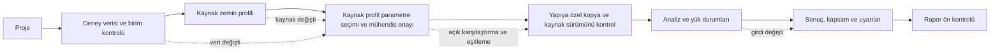

# GeoTek — kullanılabilirlik iyileştirme önerileri

**Tarih:** 22 Ekim 2026 · **Dayanak sürüm:** `b9392f9` · **Hedef:** yeni başlayan ve deneyimli geoteknik mühendisinin aynı veriyi izlenebilir biçimde hazırlayıp doğru kapsamda hesaplatabilmesi.

Bu belge ayrı bir tasarım çalışmasıdır. Öneriler gerçek tarayıcı gözlemlerine ve [işlev/mühendislik incelemesine](2026-10-22-arayuz-islev-muhendislik-incelemesi.md) dayanır; kullanıcı görüşmesi, kullanılabilirlik katılımcı araştırması veya ölçülmüş verim artışı olarak sunulmaz. Katsayı, yöntem ve mühendislik varsayımları tasarım sırasında değiştirilmez. “Basitleştir” önerisi birim, kaynak, onay veya uygulanabilirlik bilgisinin gizlenmesini içermez.

## Hedef deneyim ve öncelik

Kullanıcı her ekranda şu dört soruya cevap bulabilmelidir: **Hangi proje ve veri üzerinde çalışıyorum? Bu değer kaydedildi mi? Hesaba hangi onaylı profil girecek? Şimdi ne yapmalıyım?** Hesabın sonucu ile sonucun geçerliliği ayrı gösterilmelidir. Hesaplanamayan veya güncel olmayan sonuç, düşük risk veya başarılı tasarım rengi almamalıdır.

Öncelikler ana rapordaki P1/P2/P3 ile uyumludur; P1 veri/karar bütünlüğü, P2 akışı tamamlayabilme ve anlaşılabilirlik, P3 ince işçilik içindir. **Efor** kaba göreli tahmindir: S tek bileşen/metin, M birden fazla ekran veya ortak durum yönetimi, L frontend-servis-rapor sözleşmesi veya kapsamlı tasarım değişimi. Takvim ve maliyet taahhüdü değildir.

## İki kullanım yolu, tek veri modeli

Yeni mühendis için **Rehberli hazırlık** seçeneği proje→veri→profil→parametre→analiz→sonuç→rapor sırasını açıklar. Her adım gerçek hazır olma durumuyla işaretlenir; eksik adımın yanında neden ve düzeltme bağlantısı bulunur. Deneyimli mühendis **Hızlı çalışma** ile doğrudan ilgili modüle gidebilir, klavyeyle alanlar arasında ilerleyebilir ve önceki görünümünü koruyabilir. Hızlı yol da aynı veri doğrulama, mühendis onayı ve stale denetimlerinden geçer.



Bu hat kaynak profilden çalışma yoludur; elle yapıya özel giriş ayrı doğrulama akışıdır. Yapı kopyasının düzenlenmesi kaynak profil onayı veya değişikliği değildir. Kaynak profil onayı ile kopyanın kaynak sürümünü kontrol etme ayrı işlemlerdir; bu şema mevcutta zorunlu olmayan tüm alanlar için yeni onay şartı getirmez.

| Yolculuk adımı | Yeni mühendisin ihtiyacı | Deneyimli mühendisin ihtiyacı | Ortak kabul ölçütü |
|---|---|---|---|
| Proje | Aç/Kur/Örnek seçimini ve dosyanın nerede olduğunu anlama | Son proje, arama, çoğaltma, hızlı açma | Proje adı ve aktif kayıt konumu görünür; içe/dışa aktarma ayrı adlandırılır |
| Veri | CSV şablonu, birim ve ondalık örneği | Tekrarlı dosya importu, sütun eşleme tercihi | Sayı/birim önizlemesi onaylanmadan veri eklenmez |
| Profil | Tabaka önerisinin yorum olduğunu öğrenme | Öneriyi karşılaştırıp sınırları hızla düzenleme | Öneri kaynak profili sessiz değiştirmez; kaynağa dönüş mümkündür |
| Parametre | Ölçüm/korelasyon/manuel değeri ayırt etme | Geçerli adaylar ve kaynaklar üzerinden toplu inceleme | Onaysız, uygun olmayan veya stale değer açık görünür |
| Analiz | Eksik girdiyi ve kapsam dışı durmayı anlama | Kullanılan yöntem, yük durumu ve katsayıları hızla kontrol | Eksik değer otomatik ve sessiz mühendislik varsayımıyla tamamlanmaz |
| Sonuç | Kontrolün ne anlama geldiği ve sonraki işlem | Yöneten durum, diyagram ve talep değerleri | Kaydedilmiş girdi kimliğiyle sonuç ilişkilidir; güncellik gösterilir |
| Rapor | Raporun neden hazır olmadığını öğrenme | Bölüm seçimi ve izlenebilir kaynak/sonuç özeti | Ön kontrol tüm blokajları listeler; yalnız ilk hatayı söylemez |

## Önerilen ekran hiyerarşisi

Sol gezinti ürünün gerçek iş akışını taşısın: **Proje / Veriler / Zemin profilleri / Yapılar ve analizler / Sonuçlar / Rapor / Eğitim**. Bunların altındaki ayrıntılar bağlam içinde açılsın. Yapı düzenleme ekranında profil kaynağını ve yapıya özel kopyayı aynı panelde ilişkilendirin. Eğitim bağlantısı ilgili form alanından ilgili konuya gitsin; kullanıcı geri döndüğünde girdi taslağı korunmuş olsun.

```text
GeoTek | Proje: Örnek saha       Türkçe   Görünüm   Yardım
---------------------------------------------------------
Proje   | Palplanş P-01                 Kaydedildi 14:32
Veriler | Profil: P-01 kopyası ← Saha profili v3
Profiller| [Girdi] [Zemin] [Yükler] [Kontroller] [Sonuç]
Yapılar | Hazır olma: 1 eksik parametre → İncele
Sonuçlar| Geometri    | su ve yük    | yöntem/katsayı
Rapor   | ...        | ...          | ...
Eğitim  | [Kaydet]      [Kaydet ve hesapla]
```

Bu yerleşim bir tasarım önerisidir. Mevcut menü etiketlerinin birebir dökümü değildir. Eğitim şekil galerisinin normal ürün menüsünde bulunmaması tek başına ürün hatası sayılmaz; geliştirici/inceleme sayfası olarak kalabilir.


Önerilen yerleşim (tasarım şeması):

```text
PROJE: [proje adı]                    [Kaydedildi • saat] [Kaydet]
Görünüm: [Rehberli | Hızlı]           [Proje ayarları]

Proje → Saha verisi → Profil → Parametre → Analiz → Sonuç → Rapor
  ✓        ✓/Elle       ✓       !          ○        ○       ○

SIRADAKİ ADIM: Tasarım parametrelerini gözden geçir
"Profiliniz hazır. Analizde kullanılacak değerleri seçip onaylayın."
[Parametrelere git]   [Bu adım neden gerekli?]

YAPILAR                         SON İŞLEMLER
[İstinat duvarı ekle]            [Duvar A • veri değişti]
[Palplanş / iksa ekle]           [Profil B • 3 tabaka]
```

## Öneri kartları

### UX-Ö01 — Tek ve açık kayıt modeli

**Bağ:** yerel yapı taslağı ile genel proje kaydının ayrışması; ana rapordaki işlev bulguları ve stale sonuç korumaları. **P1 · L.**

Proje üst çubuğunun kaydetme düğmesi ile modül formunun kaydı aynı kullanıcı beklentisini karşılamalıdır. Önerilen tek model: **açık proje kaydı**. Her editörün değişiklikleri ortak bir taslak durumunda toplansın; üst “Kaydet” bütün kayıt kapsamını doğrulayıp atomik olarak kalıcılaştırsın. Yerel Kaydet konumları aynı işleme bağlansın veya kaldırılıp yalnız mühendislik işlemi olan “Uygula” ile “Onayla” adları korunsun. Taslak kurtarma için geçici saklama “Kaydedildi” anlamı taşımasın. Duvar yükleri için gerçek kalıcı kayıt yolu eklenmeden yalnız düğme adı değişikliği FUN-001’i çözmez. Onay, proje kaydından ve hesap güncelliğinden ayrı durumdur; bütün kayıt adımları tamamlanmadan başarı mesajı verilmesin.

Yapı alanı değiştiğinde sayfa başlığına “Kaydedilmemiş değişiklikler” ekleyin. Sayfadan çıkış, proje değiştirme ve yenilemede aynı koruma uygulansın. “Kaydet ve hesapla” önce başarılı kaydı beklesin, sonra o kayıt hash'iyle iş başlatsın. Kayıt başarısızsa hesap başlamasın.

**Örnek metin:** “Bu yapıda 3 değişiklik var. Sonuç önceki girdilere ait.” Eylemler: **Kaydet ve hesapla / Değişiklikleri incele / Değişiklikleri geri al**. Geri al veri kaybı yarattığı için kapsamını açıkça söyleyin.

**Kabul:** palplanş geometrisini değiştir→üst kaydı kullan→yenile akışında değer kalır; aynı işlem duvar ve profil için de geçer. API hatasında taslak korunur ve başarı bildirimi çıkmaz; gezinme uyarısı tüm modüllerde tutarlı çıkar. Bekleyen iş sırasında değişen girdi, eski işi güncel sonuca dönüştüremez.

### UX-Ö02 — Başlangıç ve boş durumları sonraki işleme bağlama

**Bağ:** veri/profil/parametre eksikliği içeren ilk kullanım; ENG-A-002 ve uygulanabilirlik. **P2 · M.**

Boş panelde yalnız “veri yok” yerine gerekli girdiyi, kabul edilen biçimi ve kullanıcının sonraki işlemini gösterin. “Henüz CPT/SPT yok. CSV içe aktarın veya sondaj ekleyin.” altında iki eylem ve indirilebilir şablon bulunsun. Profil yokken “Önce deney verisinden tabaka önerisi üretin veya yorumlanmış profili manuel kurun.” deyin. Bu iki yolu aynı mühendislik işlem gibi göstermeyin.

Yeni projede ilerleme sayacı “Tamamlandı 3/7” şeklinde veri varlığına dayanmasın; “Veri var, parametre onayı eksik” gibi gerçek durumu bildirsin. Örnek proje kullanıcı projesinden ayırt edilsin; örnekteki sayılar tasarım varsayımı diye aktarılmasın.

**Kabul:** boş projeden ilk geçerli analize giden her blokajın doğrudan ilgili alan/ekrana bağlantısı vardır. Kaynak verisi bulunmayan korelasyon için aktif fakat sonuçsuz düğme yerine gerekçe gösterilir.

### UX-Ö03 — İçe aktarmayı üç adımlı bir kontrol akışına çevirme

**Bağ:** ENG-A-001 (doğrudan import kapsamı), ENG-A-006 (kısmi u2), ondalık/sütun eşleme gözlemleri. **P1 veri doğruluğu / P2 akış · L.**

1. **Dosya ve sayı biçimi:** ayırıcı, ondalık işareti, başlık satırı, ilk beş satır ham önizleme.
2. **Sütunlar ve birimler:** derinlik→m, qc→seçilen birim, fs/u2→seçilen birim; ham değer ve SI karşılığı yan yana. Birimler UI HTTP yolunda açık gönderilmeye devam etsin. Başlıkla seçim çelişirse kullanıcı çözsün; bilinmeyen birim sessizce MPa olmasın.
3. **Doğrulama ve ekleme:** satır sayısı, eksik/tekrarlı derinlik, eksik u2 ve dönüştürme özeti. Ret edilen satır satır numarasıyla gösterilsin.

**Örnek:** “2. satırda u2 eksik. Eksik değer ölçülmüş 0 kPa değildir.” Kullanıcıya desteklenen eylemler gösterilsin: dosyayı düzelt, uygun satırları seç veya açık varsayımı onayla. Mühendislik motoru eksik maskesi taşıyamıyorsa son seçenek sunulmasın. Aynı şekilde “qc (kN/m2)” için desteklenmiyor uyarısı ya da açık kPa eşlemesi gerekir; UI'da zaten zorunlu qc_unit bulunması doğrudan Python import kusurunun erişim kapsamını değiştirmez.

**Kabul:** `5000 kPa` ile `5 MPa` aynı SI değerini gösterir; `1,5` derinliği 15 diye sessiz yorumlanmaz; hata metni sütun ve satırı belirtir. Veri değiştirilince ilişkili öneri/onay stale olur; neden ve kapsam gösterilir.

### UX-Ö04 — Profil kaynağı, kopya, onay ve stale zincirini görünür kılma

**Bağ:** kaynak profili değiştirmeme kuralı; profil kopyalama/yenileme; stale/409 korumaları. **P1 · L.**

Her yapı profilinin başında “Kaynak: Saha profili / Yapıya özel kopya: P-01 / Kaynak sürümü: …” gösterin. “Kaynağı yenile” yerine **“Kaynak değişikliklerini karşılaştır”** açın: eklenen/silinen tabakalar, sınır farkları, değişen deneyler ve etkilenen onaylar. Kopyaya al eylemi kaynak profili değiştirmesin. Tabaka bölmede yeni parçaların parametre ve onay durumunun ne olacağı işlem öncesinde açıklansın.

**Örnek:** “CPT-02 değiştiği için 2 tabakanın önerisi güncel değil. Mevcut onaylı değerleri inceleyin; otomatik değiştirilmedi.” Butonlar: **Farkları incele / Önerileri yenile / Onayı yeniden değerlendir**. Hash teknik ayrıntısı açılır bölümde tutulabilir; kullanıcı için değişen veri adı ve zaman önce gelir.

**Kabul:** kaynak düzenleme yapıya özel kopyayı sessiz değiştirmez; yenileme mühendisin elle seçtiği değeri açık işlem olmadan silmez. Eski parametre hash'iyle onay veya rapor talebi reddedilince taslak korunur; sayfayı sıfırlama önerilmez.

### UX-Ö05 — Parametre ekranını karar verebilecek kartlara bölme

**Bağ:** ENG-A-002/005/008; geniş tablo ve dar ekran gözlemleri. **P1 geçerlilik / P2 düzen · L.**

Tabaka başlığında derinlik, USCS, davranış, kaynak deney ve hazır olma durumu bulunsun. Her parametre üç seviyede gösterilsin: **Mevcut tasarım değeri → Seçilebilir adaylar → Yöntem ayrıntısı**. Aday satırında değer+birim, yöntem, veri sayısı/derinlik aralığı, geçerlilik ve uyarı bulunsun. Ortalama, bağımsız yöntemlerin ortak onayı gibi görünmesin. Bilinen kil tabakasında kum bağıntısını “geçerli” rengiyle sunmayın; zemin bağlamı kullanılarak aday uygunluğu hesaplansın.

Gerekli kaynak eksikliği ile fiziken olanaksız çıktı ayrılmalı. Negatif su/E veya Dr>%100 için manuel “onayla” düğmesi hesap kısıtını dolanmasın; önce geçersizlik çözülmeli. Yakınsamayan CPT türevi “Uyarı var ama sonlu” diye normal sonuca karışmamalı; durum kartı kapsamı göstermeli.

**Örnek:** “φ′ — bu tabaka CL / drenajsız olarak tanımlı. Kum korelasyonları öneri havuzuna alınmadı.” Yeni katsayı veya zemin parametresi önerilmez.

**Kabul:** öneri/değer/onay farklı durumlar olarak kalır. Kaynak ve geçerlilik özeti hem masaüstü hem dar ekranda okunabilir; tüm sayısal parametrelerin birimi görünür. Toplu onay öncesi geçersiz/stale adaylar ayrı listelenir.


Önerilen yerleşim (tasarım şeması):

```text
Profil [CPT profili ▾]   Tabaka [1 • 0–5,975 m ▾]
Onay özeti: […]        [Yalnız ilgilenmem gerekenler]

PARAMETRE    SEÇİLEN / BİRİM   YOL / KAYNAK   DURUM         EYLEM
φ′           [mevcut değer]   Korelasyon/CPT  İnceleme      [Aç]
γsat         —                Seçim yok       Eksik         [Aç]
┌ γsat ayrıntısı ─────────────────────────────────────────┐
│ Aday yok. [Elle gir]   [Kaynak ve gerekçe]               │
│ [Seçimi uygula]   [Görünen seçimi onayla]                │
└────────────────────────────────────────────────────────┘
[Uygulanmış seçimleri incele] → [Onay özeti ve kapsamı]
```

### UX-Ö06 — Formları mühendislik görevi ve veri bağımlılığına göre gruplama

**Bağ:** duvar/palplanş/ankraj form gözlemleri; ENG-C-001/002 ve kod-katsayı kapsamı. **P1 kritik alanlar / P2 düzen · M/L.**

Her yapı için sıralama **Geometri → Zemin → Su → Yükler → Yöntem ve katsayılar → Kontrol özeti** olsun. Temel alanlar ilk görünümde; nadir seçenekler “Gelişmiş” bölümünde bulunsun. Gelişmiş bölümde varsayılan dışı değer varsa kapalı başlıkta “3 özel değer” gösterin. Eksik zorunlu katsayı gelişmiş bölümün içinde gizlenmesin.

Su alanları **arka/ön × arazi/tasarım/deprem** matrisiyle gösterilsin; kaynaktan gelen, yapıya özel ve varsayılan değerler ayrı işaretlensin. Tek ön-su skalerini dört farklı mühendislik alanına eşdeğer göstermeyin. Desteklenmeyen ayrıntı varsa önce mevcut kaydın bu bilgiyi taşıdığını açıklayın; formun kaydı sadeleştirerek bozmasını engelleyin. SDS eklemek statik kontrolü kaldırıyormuş gibi bir akış tasarlamayın; yük durumlarını listede gösterin.

**Örnek:** “Statik kontrol: hesaplanacak / Deprem kontrolü: SDS eksik / Yöneten durum: hesap sonrası belirlenecek.” Katsayı boşsa “Kaynakta değer yok; proje için gerekçeli mühendis girdisi gerekli” açıklaması ve kaynak durumu gösterilsin; boş yerine 1 yazılmasın.

**Kabul:** tüm alanlarda sembol+Türkçe ad+birim+geçerlilik aralığı vardır; q, yatay izdüşüm/eğimli alan temelini söyler. TBDY null katsayıları kullanıcı girdisi olmadan tamamlanmaz; WA su katsayısı gerekliyse nedeni su bölümünden ilgili alana bağlanır. Ankraj/kazık aralıkları ve birimmetre/üye başına talepler ayrı etiketlenir.

### UX-Ö07 — Sonuç başlığını güven ve güncellik özeti yapma

**Bağ:** ENG-A-003/007/008, ENG-B-002/004, ENG-C-001/003/004; stale iş sonuçları. **P1 · L.**

Sonuç üst bölümünde **hesap zamanı, girdi sürümü, profil/onay durumu, yöntem ve yöneten yük durumu** gösterin. “Geçti” yalnız gerçekten tamamlanan kontrolün etiketidir; tüm uygulama/mevzuat uygunluğu anlamına gelmesin. “Hesaplanamadı”, “kapsam dışı”, “yakınsamadı”, “girdi değişti”, “kısmi sonuç” ve “kontrol başarısız” ayrı görünümler olsun.

Tamamen geçersiz FS kapsamını “çok düşük LPI” rengiyle göstermeyin. Mevcut web DTO LPI taşımadığından bu önerinin LPI kısmı motor/summary düzeltmesi ve gelecekteki sunum sözleşmesi içindir; bugünkü UI'da yanlış LPI görüldüğü iddiası değildir. LPI su kırpması örneklerinde mevcut yanlış değer yüksek/konservatiftir; çözüm etiketi değiştirmek değil integrali ve kapsamı düzeltmektir.

**Kabul:** girdi değişince sonuç başlığı görünür biçimde güncel değil olur; eski grafikler güncel çıktı gibi kalmaz. Her kontrolün yük durumu ve talep/direnç değeri izlenir; statik ve deprem sonuçları tek sayıya indirgenmeden yöneten değer seçimi açıklanır.

### UX-Ö08 — Diyagram ile tasarım özetini aynı modele bağlama

**Bağ:** ENG-C-003/004 ve tek ankrajın bilinçli maxT/maxM zarfı; ENG-B-004. **P1/P2 · L.**

Basınç, kesme ve moment grafiklerinde kullanılan model açık yazılsın. Tributary reaksiyonlarıyla hinge diyagramı birlikte sunulacaksa iki ayrı sekme ve açıklama gerekir; aynı çözümün kuvvetleri izlenimi verilmesin. `v_max` alanı tüm duvar maksimumu değilse alanın tanımı ve kesit talebindeki kullanımı önce düzeltilsin. Tek ankrajda farklı modellerden konservatif maksimum seçimi açıklanmışsa bu tasarım tercihi korunur; çizim hangi modele ait olduğunu belirtir.

Ankraj örtü kartında genel “Talep/Sınır” yerine **“Gerçek örtü8,57m ≥ gerekli4,50m — sağlanıyor”** yazılsın; bu örnekte hesap doğru, yönlü karşılaştırma etiketi iyileştirilir. Sıvılaşma FS grafiğinde1,0 referansına ek olarak gerçek hedef GS1,1 ve “Sınırda” durumunun anlamı görünür olsun; hedef çizgisi hesap değerini değiştirmez. Katman adı yerine32karakter UUID grafiğin üstüne basılmasın; insanın tanıdığı ad/derinlik ve teknik ayrıntıda kimlik kullanılsın.

Grafikte eksen/birim ve referans kotu sürekli görünür; hover bilgisine klavyeyle ve tabloyla erişilir. “Sonucu indir” sayısal noktaları, yöntem ve girdi sürümünü taşısın. Seçilen kayma dairesi geometrik geçerlilikten geçmemişse güzel bir daire çizimi sonuç onayı gibi kullanılmasın.

**Kabul:** aynı modelde verilen reaksiyonlar ile kesme sıçramaları bağımsız denge kontrolünde uyumludur; zarf talebi farklıysa fark etiketlidir. Birimmetre ve kazık/ankraj başına değerler aynı sütunda karışmaz.

### UX-Ö09 — Raporu üretmeden önce içeriği ve engelleri gösterme

**Bağ:** stale rapor reddi, DOCX/TR-EN işlev kontrolleri, kaynak ve kapsam sınırlamaları. **P1/P2 · L.**

Rapor ekranı seçilen bölümler için kontrol listesi sunsun: hesap yok, sonuç eski, parametre onayı eksik, desteklenmeyen durum, kaynak/katsayı belirsizliği. Her engel ilgili ekrana dönsün. Engel kalkmadan rapor düğmesini aktif tutmak gerekiyorsa, neden üretilemediği form yakınında ve odaklanabilir alanda açıklansın.

Önizleme; proje kimliği, girdi özeti, yöntem, kaynak durumu, katsayı/override gerekçesi, yük durumu, uyarılar ve kapsam dışı işleri içersin. Tarihsel `verified` metadatası yeni kaynak onayı gibi basılmasın. “Onaylı parametre” ile “kaynak doğrulanmış bağıntı” ayrı ifadeler olsun. Rapor indirme sonucu dosya adı ve seçilen dil ile teyit edilsin.

**Kabul:** gerçek HTTP 409 rapor reddi, iş polling içindeki HTTP 200+failed durumundan ayrı kullanıcı mesajına çevrilir. Hata sonrası taslak ve bölüm seçimi korunur. TR raporda çevrilemeyen metinler ve EN raporda ham i18n anahtarları kalmaz; sayısal değer ve birim diller arasında değişmez.


Önerilen yerleşim (tasarım şeması):

```text
RAPOR HAZIRLIĞI                    Dil [Türkçe ▾]
Proje kaydı          [Kaydedildi / Kaydet gerekli]
Duvar A              [Güncel] [ASD • İleri]
Palplanş B           [Eski]   [Girdilere git]
Profil C             [Yeniden inceleme] [Parametrelere git]

Seçilen bölümler: […]  Dışarıda kalacaklar: […] + nedeni
[Hazırlığı yenile]                  [Raporu oluştur ve indir]
```

### UX-Ö10 — Eğitimde yöntem, örnek ve şekli tek doğrulanabilir bütün yapma

**Bağ:** ENG-A-004/011/012, ENG-B-008/009/010, ENG-C-005. **P2 · M/L.**

Masaüstünde bölüm bağlantılı **içindekiler**, dar ekranda açılır bölüm listesi; aktif bölüm ve kalıcı bölüm bağlantısı gösterilsin. Öğrenci/mühendis görünümü değişince eşdeğer bölüm, ilgili uygulama aracından dönüşte okuma konumu ve form taslağı korunsun. Örneğin “Plastisite → Formül → Çözümlü örnek → Uygulamada dene → Okumaya dön” zinciri açık olsun.

Her ders “Ön koşullar / Kullanıldığı yer / Formül ve birimler / Hesap örneği / Sınırlar / Kaynak durumu” düzeni kullansın. Mühendis görünümü hızlı formül ve kapsam tablosunu, öğrenci görünümü adım adım açıklamayı açsın; ikisi aynı hesap ve figür parametrelerini paylaşsın. Ders içinde örnek girdiler başlıkta veya şekil altı tabloda tekrar verilsin. Kum H10 ve kil H8 gibi farklı örnekleri ortak caption altında karıştırmayın.

MSF eğrisinin yöntem adı, denklem ve çizilen fonksiyonu birlikte düzeltilsin; eksen doğru eğriyi kesmesin. LPI alıştırmasında ilk hücre tanımı aynı örnekle tutarlı olsun. Bishop giriş/çıkış noktaları örnekteki daireden türetilsin; direnç oku kuvvetin hangi cisme etki ettiğini göstersin. Şematik şekiller “ölçekli hesap diyagramı” gibi sunulmasın.

**Örnek:** “Bu şekil şematiktir. Kendi projenizin sonucunu görmek için Analiz ekranına dönün.” Kaynağın görülmediği durumda “Kaynak atfı mevcut; özgün sayfa doğrulaması bekliyor.”

**Kabul:** seçilen bölüme klavyeyle ulaşılır;390px’de bölüm listesi açılıp kapatılır; ilgili araca gidip dönünce bölüm/okuma konumu ve form taslağı korunur. Öğrenci/mühendis görünüm geçişi eşdeğer bölümde kalır. Her eğitim örneğinin girdi ve beklenen değeri ayrı aritmetik kontrolden geçer; motor replay'i bağımsız kaynak doğrulaması olarak etiketlenmez. Eğitimden uygulamaya dönüşte kaydedilmemiş taslak korunur.

### UX-Ö11 — Dar ekran, büyütme ve klavye düzeni

**Bağ:** gerçek 390 px/dar ekran ve CSS zoom:2 büyütme simülasyonu; geniş profil/parametre tabloları, menü ve toast etkileşimi. **P1 temel eyleme erişim / P2 diğer düzen · M.**

Dar ekranda sol menü açılır çekmeceye dönüşsün; açılınca odağı içine alsın, Escape ile kapansın, kapatılınca tetikleyiciye dönsün. Tablo başlıkları ve birimler kaybolmadan tabaka kartlarına veya seçilebilir sütunlara geçilsin. Yatay kaydırma gerekiyorsa yalnız tablo içinde ve görünür ipucuyla olsun; ana form eylemleri ekrandan kaçmasın. Toast, kapatma/menü/kaydetme düğmelerini örtmesin; kalıcı hata için toast tek taşıyıcı olmasın.

Form başlıkları, dialog adları, düğme erişilebilir isimleri ve görünür odak düzenli olsun. Hata özeti ilk hataya götürsün; grafiklerin başlık, birim ve sayısal tablo alternatifi bulunsun. Renk yanında metin/simge kullanılsın. Yapışkan alt eylem alanı %200'de son form satırını örtmesin.

**Kabul:** 390 CSS px genişlik ve gelecekte ayrıca gerçek %200 tarayıcı yakınlaştırmasında proje aç→profil incele→parametre seç→kaydet işlemleri temel eylem kaybı olmadan tamamlanır; yalnız klavyeyle dialog aç/kapat ve alan hatasına gitme yapılır. Ekran okuyucu ve tam WCAG uygunluğu bu incelemede sınanmadı; bunlar sonraki doğrulama hedefidir, mevcut uyumluluk iddiası değildir.


Önerilen yerleşim (tasarım şeması):

```text
390 px
┌──────────────────────────────────┐
│ [☰] Profil                      │
│ Proje: [adı]      [⋯ dil / tema] │
│ Değişiklikler var       [Kaydet] │
├──────────────────────────────────┤
│ Profil [Kum profili          ▾]  │
│ Kaynak / durum / kullanım özeti  │
│ [Yeraltı suyu] [Tabakalar]       │
│ Tabaka 1 • 0–10 m               │
│ Davranış     [Drenajlı       ▾]  │
│ γ (kN/m³)    [              ]   │
│ γsat (kN/m³) [              ]   │
│ [Diğer alanlar] [Parametreler]   │
└──────────────────────────────────┘
```

### UX-Ö12 — TR/EN dil, sayı biçimi ve terim tutarlılığı

**Bağ:** TR/EN görünüm ve hata metinleri; sayı girişinde ondalık ayracı; mühendislik sembolleri. **P2 · M.**

Dili değiştirirken açık proje, taslak, seçim ve grafikteki birimler korunsun. Türkçe arayüzde ondalık virgül kabul politikasını açıkça belirleyin; dosya importunda ayırıcıdan ayrı seçtirin. Ekranda `1.250,5` gösterimi depolamadaki SI değerini değiştirmesin. Rapor ve CSV dışa aktarımı kendi sayı biçimini başlıkta veya şemada bildirsin.

Terim sözlüğü: **kaynak profil / yapıya özel kopya / tasarım değeri / öneri / mühendis onayı / güncel değil / yakınsamadı**. “Valid”, “passed”, “verified” için tek “onaylandı” sözcüğü kullanılmasın. Parametre ismi çevrilirken sembol ve birim sabit kalsın. Kod hata anahtarları kullanıcının düzeltme metnine çevrilsin; ayrıntı alanında teknik kod görülebilir.

**Kabul:** aynı proje TR→EN→TR geçişinde sayısal hash veya değer değiştirmez; tüm birim/ondalık örnekleri dile uygun ve tutarlıdır. Hata metni kullanıcı işlemini belirtir; ham anahtar veya iç servis dili ana mesaj olmaz.


### UX-Ö13 — Tabakalama ve sınıflandırmanın veri bağımlılıklarını açıklama

**Bağ:** UX-005/008, ENG-A-010 ve USCS/SBTn akışı. **P2/M.**

Tabakalamada önce kaynak sondaj/CPT, sonra gerilme hesabında kullanılacak profil ve kapsadığı derinlik gösterilsin. BH-UX-dot13,50m'ye giderken aktif profil10m ise işlemden önce “Seçilen sondaj13,50m; gerilme profili10,00m'de bitiyor. En az13,50m'yi kapsayan profil seçin.” ve **Profil seç** eylemi verilsin. Bu, geçerli CSV'yi kullanıcıya düzelttiren genel doğrulama hatasının yerini alsın. Öneri→mühendis kontrolü→profil oluştur adımları ayrı olsun; sabit alt bar kontrollü γ sayısı ve YASS'ı özetlesin. Çok basamaklı adaylar yalnız gösterimde uygun hassasiyete indirilsin; tam değer ayrıntıda ve hesapta korunsun.

USCS'de FC, gravel ve sand toplam tutarlılığı kontrol edilsin; FC/gravel alanlarının ayrı0–100 sınırı yetmez. Organik sınıfların değerlendirilmediği ve tam/varsayımlı sonuç açık yazılsın. SBTn “CPT davranış sınıfı” olarak tanıtılsın; USCS laboratuvar sınıfına birebir çevrildiği izlenimi verilmesin. Geçici örnek hesabın sondaja kaydedilip kaydedilmeyeceği önceden açıklansın.

**Kabul:** aynı sondaj10m profilde eyleme götüren hata,15m profilde geçerli öneri verir. Öneri kendiliğinden onaylanmaz; kaynak/ayar değişince eski öneri güncel değil olur. FC20+gravel90 girişi açık tutarsızlık bildirir; CL örneğinin açıklama ve organik kapsam notu seçili dilde çıkar.

### UX-Ö14 — İş ilerlemesi ve başarısızlık durumlarını gerçek sözleşmeye bağlama

**Bağ:** gerçek202→jobdone, stale_structure discard ve iptal kontrolleri; yeni tasarım hedefi. **P2/M.**

İş başlığında yapı, girdi revizyonu ve gerçek durum gösterilsin: **Sırada / Çalışıyor / Tamamlandı / İptal edildi / Başarısız**. Motor gerçek ilerleme yüzdesi sağlamıyorsa zaman veya yüzde uydurulmasın. Çift tıklama ikinci iş yaratmasın. İptal isteği gönderilince terminal cevap gelene kadar “İptal isteniyor” denilsin; yalnız isteğin gönderilmesi başarı değildir. Önceki geçerli sonuç korunuyorsa zaman ve girdi sürümüyle eski sonuç olarak gösterilsin.

**Örnek:** “İş sırasında yapı/proje değişti. Bu işin sonucu kaydedilmedi. Güncel girdilerle yeniden hesaplayın.” Bu durum polling HTTP200 içinde failed/stale_structure/discarded=true olabilir; HTTP409 rapor reddi ayrı hata yoludur.

**Kabul:** yenileme mevcut işe yeniden bağlanır; eski iş güncel kaydı değiştiremez. Duvar iptal görüntüsü47 terminal UI mesajı kanıtı değildir; terminal cancelled API kaydıyla teyit edilir. Yeni tasarım terminal UI durumunu da açık gösterir ve gerçek API ile kontrol edilir.

## Uygulama sırası ve doğrulama planı

| Sıra | Teslim | Öncelik / efor | Tamamlanma kanıtı |
|---|---|---|---|
| 1 | Hesap ve veri bütünlüğü kusurları; eski sonuç/iş/rapor durumu; kayıt modeli;390px’de temel eyleme erişim engeli | P1 / L | Hedefli sayısal regresyon + gerçek UI/API tekrarları; mühendislik değişimlerinde depo bağımsız inceleme kuralı |
| 2 | Import önizleme; profil/kopya/onay karşılaştırması; parametre uygunluğu | P1–P2 / L | Hatalı/eksik/birimli dosya örnekleri, güncel ve stale yollar, korunmuş taslak |
| 3 | Form grupları, durum başlıkları, rapor ön kontrolü | P2 / M–L | Yeni ve deneyimli mühendis görevlerinin ayrı tamamlanma gözlemi |
| 4 | Dar ekran/klavye/TR-EN; eğitim düzeltmeleri | P2 / M–L | Masaüstü/dar ekran/gerçek %200 hedefi, klavye; eğitim sayısal karşılaştırmaları |
| 5 | İnce etkileşimler ve kişisel hızlı yol tercihleri | P3 / S–M | Kullanıcı araştırması sonrası görev süresi/hata oranı karşılaştırması |

Yeni kullanıcı değerlendirmesinde boş projeden CPT/SPT importu, profil kurma, parametre seçip onaylama ve ilk analize ulaşma görevleri verilsin. Deneyimli kullanıcıda mevcut yapı geometrisini değiştirme, kaynak veri yenilenmesini değerlendirme, yöneten yük durumunu bulma ve raporu üretme görevleri kullanılsın. Ölçümler: tamamlanma, geri dönme, kayıt kaybı, yanlış birim yorumu, stale sonucu güncel sanma ve gerekçeyi doğru açıklama. Şimdiki inceleme bu metriklere başlangıç değeri üretmedi; hedef süre veya yüzde başarı uydurulmadı.

İlk teslimlerde doğruluk ve izlenebilirlik düzeltilmeden görsel sadeleştirme tek başına başarı sayılmamalıdır. Kullanıcı araştırması ve ekran okuyucu kontrolü için ayrı görev planlanmalı; mevcut tarayıcı gözlemleri tüm kullanıcıların davranışına genellenmemelidir.


## Gözlenen bulgularla öneri eşlemesi ve kanıt seçkisi

Bu eşleme tasarım önerisinin gözlem mi, mühendislik sonucu mu, yoksa yeni tasarım hedefi mi olduğunu ayırır. Ana raporun bulgu kimlikleri kalıcı referanstır.

| Gözlenen bulgu | Öneri | Temsilî kanıt |
|---|---|---|
| UX-001:390px profil taşması; FUN-010:800px grafik küçülmesi | UX-Ö11, Ö08 | [Profil](2026-10-22-inceleme-kanitlari/ux/09-profile-mobile.png), [mobil eğitim](2026-10-22-inceleme-kanitlari/ux/36b-education-mobile-settled.png) |
| UX-002:profil/parametre onayı çelişiyor | UX-Ö04, Ö05, Ö07 | [Parametre](2026-10-22-inceleme-kanitlari/ux/29-param-stale.png), [profil](2026-10-22-inceleme-kanitlari/ux/46-stale-profile-row.png) |
| UX-003:γsat boyutsuz etiketi | UX-Ö05, Ö06 | [γsat EN/koyu](2026-10-22-inceleme-kanitlari/ux/28-gamma-sat-en-dark.png) |
| UX-004:gizli zorunlu γ; UX-008:aşırı hassasiyet | UX-Ö02, Ö05, Ö06 | [İlk profil](2026-10-22-inceleme-kanitlari/ux/06-manual-profile.png), [öneri](2026-10-22-inceleme-kanitlari/ux/17-cpt-proposal.png) |
| UX-005:SPT aktif profil derinliği bağımlılığı | UX-Ö02, Ö03, Ö06 | [422 yüzeyi](2026-10-22-inceleme-kanitlari/ux/19-spt-proposal.png) |
| UX-006/007 ve FUN-001:kayıt/taslak kaybı | UX-Ö01 | [Kayıt kaybı JSON](2026-10-22-inceleme-kanitlari/functional/wall-draft-loss.json) |
| UX-009 ve FUN-004:TR/EN uyarılar | UX-Ö12, Ö09 | [EN DOCX](2026-10-22-inceleme-kanitlari/functional/docx/qa-all-en.docx) |
| UX-010:karar özeti yerine yoğun kartlar | UX-Ö05 | [Parametre görünümü](2026-10-22-inceleme-kanitlari/ux/22-params-viewport.png) |
| UX-011:eğitimde yön bulma | UX-Ö10 | [Öğrenci](2026-10-22-inceleme-kanitlari/ux/34b-education-student-viewport.png), [mühendis](2026-10-22-inceleme-kanitlari/ux/35-education-engineer.png) |
| UX-012:aynı adlı proje kopyaları | UX-Ö02; kütüphane kimliği ek kartı | [Yeniden içe alma](2026-10-22-inceleme-kanitlari/ux/44-project-reimported.png) |
| UX-013:toast eylemi örtüyor | UX-Ö11 | [Örtüşme](2026-10-22-inceleme-kanitlari/ux/40a-toast-blocks-close.png) |
| FUN-003:sonuçstale/kaynakstale karışıyor; FUN-007:su koşulu gizli | UX-Ö04, Ö06, Ö07 | [Etkin su girdileri](2026-10-22-inceleme-kanitlari/functional/envelope-seismic.json) |
| FUN-006/008/009:gerçek kod,LPI vaat/birim | UX-Ö07, Ö08, Ö09 | [DOCX karşılaştırma](2026-10-22-inceleme-kanitlari/functional/docx-dto-comparison.json) |

### Kütüphane kimliği için somut ek düzenleme

**UX-012 · P2/S:** aynı adlı projelerde adın altında gerçek dosya adı veya kısa konum, son kayıt zamanı ve “İçe alınmış kopya” gösterilsin. Son projelerin erişilebilir adları da ayrışsın. Örnek: “Örnek saha — ornek-saha-kopya.gtk · İçe alındı14:32”. Aynı dosyayı tekrar içe alırken yeni kopya oluşacağı bildirilir; mevcut proje açık işlem olmadan değiştirilmez. **Kabul:** aynı ad/no/mühendisli iki dosya görsel olarak ve klavye/erişilebilir ad ile ayırt edilir; dışa aktarma hedefi açık gösterilir.

### Başarılı mevcut davranışları koruma

CSV şablonu indirme ve açık MPa/kPa–ondalık seçimi; içe alma sonrası YASS isteme; önerinin onaydan ayrılması; onay öncesi gerçek değerin gösterilmesi; güncel olmayan seçimde yeniden uygulama gereği; katman böl/geri al/yinele; dil/tema değişiminde taslağın korunması; Escape sonrası odağın açan Böl düğmesine dönmesi; gerçek indirme/yeniden içe alma ve backend stale rapor/iş korumaları korunmalıdır. Düzenleme sırasında bu mevcut başarılar kabul kontrolüne eklenmelidir.

**Doğrulama sınırı:** `39-profile-zoom200.png` yerel tarayıcı menüsüyle %200 değil, CSS `zoom:2` simülasyonudur. Yukarıdaki gerçek %200 kabul ölçütü gelecek doğrulama hedefidir. Klavye kontrolü belirli bölme dialogu ve akışlarla sınırlıdır; ekran okuyucu, tüm odak sırası ve tam WCAG uyumu denenmedi.
